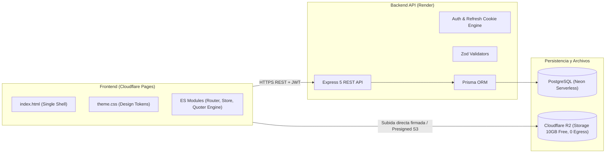
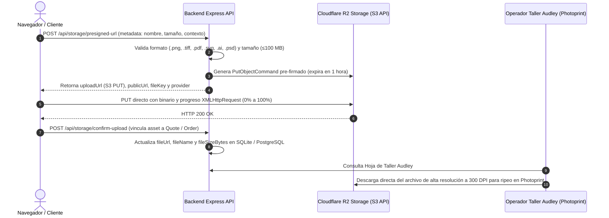

# Documentación Técnica, Arquitectura y Reglas de Negocio — Kroma Lab Sales Studio

> **Fuente Única de Verdad (Single Source of Truth):** Este documento reúne la arquitectura de software, modelos de datos, reglas de negocio de impresión UV DTF, algoritmos del cotizador, tokens del sistema de diseño (Light/Dark Mode), catálogo de endpoints y estructura física de archivos del proyecto **Kroma Lab Sales Studio**. Debe mantenerse permanentemente sincronizado con cada cambio en el código.

---

## Índice de Contenidos

1. [Visión General del Negocio y Arquitectura](#1-visión-general-del-negocio-y-arquitectura)
2. [Reglas Obligatorias de Ingeniería (Testing > 85% y Documentación)](#2-reglas-obligatorias-de-ingeniería-testing--85-y-documentación)
3. [Sistema de Diseño, Paleta de Colores y Temas (Light / Dark)](#3-sistema-de-diseño-paleta-de-colores-y-temas-light--dark)
4. [Algoritmo de Cotización y Reglas de Producción UV DTF](#4-algoritmo-de-cotización-y-reglas-de-producción-uv-dtf)
5. [Matriz Maestra de Roles y Permisos (RBAC)](#5-matriz-maestra-de-roles-y-permisos-rbac)
6. [Estructura del Monorepo y Mapa de Carpetas](#6-estructura-del-monorepo-y-mapa-de-carpetas)
7. [Arquitectura del Frontend (Vanilla HTML5, CSS3, ES Modules)](#7-arquitectura-del-frontend-vanilla-html5-css3-es-modules)
8. [Arquitectura del Backend (Express, Prisma, PostgreSQL Neon)](#8-arquitectura-del-backend-express-prisma-postgresql-neon)
9. [Almacenamiento de Archivos de Impresión (Cloudflare R2)](#9-almacenamiento-de-archivos-de-impresión-cloudflare-r2)

---

## 1. Visión General del Negocio y Arquitectura

**Kroma Lab Sales Studio** es la plataforma B2B integral de ventas, cotización y gestión operativa para el taller de impresión industrial **UV DTF** de Kroma Lab en Guatemala.

### Objetivos Estratégicos
1. **Captación de Tráfico Publicitario (Meta, TikTok, YouTube):**
   * Experiencia pública ultra veloz y sin barreras: landing page informativa y cotizador interactivo en tiempo real con simulación gráfica sobre la bobina de la impresora Audley.
   * Cierre comercial fluido: generación de cotización formal y enlace directo a WhatsApp/Lead con datos del cliente sin requerir registro previo obligatorio.
2. **Operación Interna y Fidelización B2B:**
   * Portal de autoservicio para clientes registrados recurrentes (reórdenes de pliegos, historial, subida de archivos TIFF/PNG a 300 DPI, saldo y estados).
   * Tablero de control de producción para empleados (seguimiento del flujo de la Audley: cola de impresión, impresión, laminado, corte de precisión y despacho).
   * Ventas de mostrador: registro manual de pedidos y altas rápidas de clientes no registrados para compras asistidas.
   * Escalabilidad a catálogo e-commerce para personalización de artículos promocionales terminados (termos, tazas, pachones).

### Topología de Infraestructura (Costo $0 / Q0)


---

## 2. Reglas Obligatorias de Ingeniería (Testing > 85% y Documentación)

1. **Pruebas Unitarias Obligatorias en Cada Tarea:**
   * Ningún archivo de lógica (cálculos, estado, enrutador, controladores, validadores) se entrega sin sus correspondientes pruebas en `__tests__/`.
2. **Umbral Mínimo de Cobertura (> 85%):**
   * Configurado en Vitest con límites estrictos: `statements: 85%`, `lines: 85%`, `functions: 85%`, `branches: 85%`.
3. **100% Tests Passing:**
   * Cero tolerancia a pruebas fallidas o advertencias no resueltas.
4. **Documentación Viva en `DOCUMENTATION.md`:**
   * Todo nuevo módulo, variable de entorno, cambio en precios o endpoints debe registrarse inmediatamente en este documento.

---

## 3. Sistema de Diseño, Paleta de Colores y Temas (Light / Dark)

La identidad de Kroma Lab se basa en 5 colores principales convertidos en variables CSS y tokens semánticos:

### Paleta Primaria de Marca
* **Space Indigo (`--space-indigo`):** `#21295c`
* **Regal Navy (`--regal-navy`):** `#1b3b6f`
* **Baltic Blue (`--baltic-blue`):** `#065a82`
* **Cerulean (`--cerulean`):** `#1c7293`
* **Powder Blue (`--powder-blue`):** `#9eb3c2`

### Mapeo Semántico por Tema

| Token Semántico | Modo Oscuro (`data-theme="dark"`) | Modo Claro (`data-theme="light"`) | Propósito |
| :--- | :--- | :--- | :--- |
| `--bg-page` | `#0d1224` (Indigo Profundo) | `#f4f7fb` (Blanco Hielo suave) | Fondo general del viewport |
| `--bg-surface` | `#161f3d` (Navy Oscuro) | `#ffffff` (Blanco puro) | Fondo de tarjetas y paneles |
| `--bg-surface-elevated`| `#1b294e` | `#eef3f8` (Powder Blue atenuado) | Modales, dropdowns y tooltips |
| `--border-color` | `rgba(158, 179, 194, 0.18)` | `rgba(27, 59, 111, 0.15)` | Líneas divisorias y bordes de inputs |
| `--border-focus` | `#1c7293` (*Cerulean*) | `#065a82` (*Baltic Blue*) | Enfoque de campos interactivos |
| `--text-primary` | `#ffffff` (Blanco brillante) | `#21295c` (*Space Indigo*) | Títulos y lectura principal |
| `--text-secondary` | `#9eb3c2` (*Powder Blue*) | `#475569` (Gris pizarra neutro) | Subtítulos y metadatos |
| `--text-muted` | `#64748b` | `#94a3b8` | Textos secundarios y placeholders |
| `--btn-primary-bg` | Linear Gradient (`#065a82` -> `#1c7293`) | `#1b3b6f` (*Regal Navy*) | Botones de acción principal |
| `--btn-primary-text` | `#ffffff` | `#ffffff` | Texto de botones primarios |
| `--accent-uv` | `#1c7293` (*Cerulean*) | `#065a82` (*Baltic Blue*) | Acentos visuales y barniz UV |
| `--status-success` | `#10b981` | `#059669` | Confirmaciones y badges pagados |
| `--status-warning` | `#f59e0b` | `#d97706` | Pendientes y alertas |
| `--status-danger` | `#ef4444` | `#dc2626` | Errores y cancelaciones |

---

## 4. Algoritmo de Cotización y Reglas de Producción UV DTF

El motor de cálculo emula con precisión el funcionamiento de la impresora industrial Audley:

### Parámetros de Bobina y Físicos
* **Ancho de Bobina:** 30 cm nominal.
* **Ancho Útil Imprimible (`printableWidthCm`):** `28.0 cm` (margen técnico de 1 cm por lado para tracción del film).
* **Separación entre Stickers (`marginBetweenCm`):** `0.3 cm` (3 mm).
* **Mínimo de Facturación:** `1.0 metro lineal` (`Q140.00`).

### Fórmulas del Motor Matemático
1. **Stickers por fila:**
   $$\text{stickersPerRow} = \max\left(1, \left\lfloor \frac{\text{printableWidthCm} + \text{gap}}{\text{widthCm} + \text{gap}} \right\rfloor\right)$$
2. **Filas requeridas:**
   $$\text{rows} = \left\lceil \frac{\text{qty}}{\text{stickersPerRow}} \right\rceil$$
3. **Largo físico en centímetros:**
   $$\text{lengthCm} = (\text{rows} \times (\text{heightCm} + \text{gap})) - \text{gap}$$
4. **Metros lineales reales:**
   $$\text{actualLinearMeters} = \frac{\text{lengthCm}}{100.0}$$
5. **Metros facturables:**
   $$\text{billableMeters} = \max(1.0, \text{actualLinearMeters})$$

### Escala de Precios de Impresión por Volumen
| Rango de Metros | Tarifa por Metro | Descripción Comercial |
| :--- | :--- | :--- |
| `0.01 m – 1.00 m` | **Q140.00 / m** (Tarifa Plana Base) | Pedido mínimo de entrada |
| `1.01 m – 4.99 m` | **Q115.00 / m** | Tiraje corto / emprendedor |
| `5.00 m – 9.99 m` | **Q105.00 / m** | Tiraje medio comercial |
| `10.00 m – 19.99 m` | **Q95.00 / m** | Mayorista frecuente |
| `20.00 m o más` | **Q85.00 / m** | Maquila industrial / Alto volumen |

### Servicio Opcional de Corte Recto de Precisión
* Si `includeCutting == true`:
  * `qty <= 50`: `Q0.35` / pieza
  * `51 <= qty <= 200`: `Q0.30` / pieza
  * `qty > 200`: `Q0.25` / pieza
  * **Tarifa Mínima de Corte:** `Q25.00` (si $\text{qty} \times \text{tarifa} < 25$, se cobra el piso de Q25).

---

## 5. Matriz Maestra de Roles y Permisos (RBAC)

El acceso sigue la directriz **Default-Deny**:

| Código de Permiso | Descripción | Roles Autorizados |
| :--- | :--- | :--- |
| `PUBLIC_ACCESS` | Acceso a Landing Page, información de contacto y cotizador público | `VISITOR`, `CUSTOMER`, `EMPLOYEE`, `ADMIN` |
| `SUBMIT_LEAD` | Enviar cotización pública por WhatsApp o registrar lead | `VISITOR`, `CUSTOMER`, `EMPLOYEE`, `ADMIN` |
| `VIEW_OWN_ORDERS` | Ver historial de pedidos propios y estados de producción | `CUSTOMER`, `ADMIN` |
| `CREATE_CUSTOMER_ORDER`| Crear pedido formal con subida de archivos de impresión | `CUSTOMER`, `EMPLOYEE`, `ADMIN` |
| `UPLOAD_PRINT_ASSETS` | Subir archivos TIFF/PNG pesados a Cloudflare R2 | `CUSTOMER`, `EMPLOYEE`, `ADMIN` |
| `MANAGE_PRODUCTION` | Cambiar estados de la cola de impresión Audley | `EMPLOYEE`, `ADMIN` |
| `MANAGE_ALL_ORDERS` | Ver, modificar, cancelar y facturar pedidos generales | `EMPLOYEE`, `ADMIN` |
| `CREATE_WALKIN_ORDER` | Crear pedidos en mostrador para clientes sin cuenta previa | `EMPLOYEE`, `ADMIN` |
| `MANAGE_CLIENTS` | Directorio de clientes, datos fiscales (NIT) y teléfonos | `EMPLOYEE`, `ADMIN` |
| `MANAGE_USERS` | Invitar empleados y administrar credenciales | `ADMIN` |
| `MANAGE_ROLES_PERMS` | Configurar matriz de permisos RBAC | `ADMIN` |
| `CONFIG_PRICING_TIERS`| Modificar tarifas por metro del cotizador | `ADMIN` |

### Regla Específica de Visibilidad de Marca en Navbar:
* **"KROMA LAB":** Visible universalmente para todos los usuarios (Visitantes, Clientes, Empleados y Administradores).
* **"Sales Studio":** Oculto por defecto (`display: none`). **Únicamente visible cuando el usuario tiene rol `ADMIN` o `EMPLOYEE`**. Los clientes y visitantes no registrados jamás ven el texto "Sales Studio", manteniendo un perfil limpio hacia el consumidor.

---

## 6. Estructura del Monorepo y Mapa de Carpetas

```text
kroma-lab-sales-studio/
├── GEMINI.md                       # Reglas operativas y mandatos para el Agente IA
├── DOCUMENTATION.md                # Fuente Única de Verdad viva del proyecto
├── frontend/                       # Aplicación Web Vanilla (HTML5, CSS3, ES Modules)
│   ├── index.html                  # Shell único con contenedor SPA #app, navbar reactivo y drawer
│   ├── favicon.svg                 # Emblema vectorial oficial Kroma Lab (arcoíris facetado 3D)
│   ├── _redirects                  # Configuración de routing SPA para Cloudflare Pages
│   ├── package.json                # Dependencias de testing (Vitest, JSDOM) y scripts
│   ├── vitest.config.js            # Configuración de pruebas unitarias (>85% coverage)
│   ├── src/
│   │   ├── css/
│   │   │   ├── theme.css           # Tokens de diseño y variables CSS (Light/Dark)
│   │   │   ├── base.css            # Reset, tipografía y utilidades
│   │   │   └── views.css           # Estilos de vistas, bobina, dropzone y drawer de carrito
│   │   ├── shared/
│   │   │   └── business-config.js  # Constantes de negocio espejadas para el cliente
│   │   └── js/
│   │       ├── app.js              # Punto de entrada, sincronización reactiva de rol y bootstrap
│   │       ├── router.js           # Enrutador SPA ligero con History API y guardias RBAC
│   │       ├── store.js            # Estado reactivo global (usuario, token, tema)
│   │       ├── components/
│   │       │   ├── cart-drawer.js      # Componente interactivo de carrito (drawer lateral)
│   │       │   ├── checkout-modal.js   # Modal de datos de entrega y facturación SAT
│   │       │   └── user-profile-modal.js # Modal de autogestión de perfil de usuario y conmutador de cuentas
│   │       ├── modules/
│   │       │   ├── api-client.js       # Cliente HTTP REST tipado con JWT y fallback tolerante a fallos
│   │       │   ├── quoter-engine.js    # Motor puro de cálculo matemático de cotización
│   │       │   ├── cart-engine.js      # Motor consolidado multidiseño y escalas de mayoreo
│   │       │   ├── cart-store.js       # Almacén reactivo de carrito con persistencia local
│   │       │   ├── orders-store.js     # Almacén reactivo de pedidos B2B, cobros y métricas de taller
│   │       │   ├── clients-store.js    # Almacén reactivo de cartera de clientes B2B y métricas 360°
│   │       │   ├── file-uploader.js    # Validador de archivos gráficos y extracción de preview
│   │       │   ├── roll-simulator.js   # Renderizador en Canvas 2D con centrado simétrico en bobina (28 cm)
│   │       │   └── production-store.js # Almacén reactivo de Kanban y monitor de consumo de film PET
│   │       └── views/
│   │           ├── quoter-view.js      # Vista principal del cotizador UV DTF + Dropzone
│   │           ├── orders-view.js      # Vista de gestión de pedidos, cobros y Hoja de Taller Audley
│   │           ├── production-view.js  # Tablero Kanban interactivo Audley + Monitor de Bobina (Staff)
│   │           ├── clients-view.js     # Directorio B2B y cartera de clientes (Staff)
│   │           └── users-view.js       # Administración y permisos RBAC (Admin)
│   └── __tests__/                  # 532 pruebas unitarias de frontend (> 85% coverage en 4 métricas)
│       ├── quoter-engine.test.js   # 14 tests de cálculo, mínimas y escalas
│       ├── cart-engine.test.js     # 14 tests de cálculo consolidado y formateo WhatsApp
│       ├── cart-store.test.js      # 8 tests de estado reactivo y localStorage
│       ├── orders-store.test.js    # 10 tests de almacén de pedidos, estados de pago y métricas
│       ├── orders-ui.test.js       # 15 tests de interfaz de pedidos, Hoja de Taller y roles
│       ├── clients-store.test.js   # 13 tests de directorio de clientes, segmentación y métricas
│       ├── clients-ui.test.js      # 13 tests de interfaz de cartera B2B, expediente 360° y modales
│       ├── file-uploader.test.js   # 9 tests de validación y formatos de archivo
│       ├── cart-ui.test.js         # 12 tests de interfaz de carrito y checkout modal
│       ├── store.test.js           # 5 tests de estado y reactividad
│       ├── roll-simulator.test.js  # 4 tests de Canvas 2D (centrado horizontal en bobina de 28 cm)
│       ├── production-store.test.js # 11 tests de estado Kanban y consumo de rollo
│       ├── production-kanban.test.js # 14 tests de integración de vistas y modales Kanban
│       ├── router.test.js          # 13 tests de enrutador SPA y guardias de rol
│       ├── views.test.js           # 8 tests de renderizado de vistas modulares
│       ├── app.test.js             # 24 tests de integración, roles, topbar, sidebar y WhatsApp
│       ├── api-client.test.js      # 14 tests de cliente HTTP, tokens JWT y fallback
│       └── setup.js                # Mock de Canvas para JSDOM
├── backend/                        # API REST (TypeScript, Express, Prisma, Vitest)
│   ├── package.json                # Scripts de ejecución, migraciones y test
│   ├── tsconfig.json               # Configuración TypeScript ES2022 / CommonJS
│   ├── vitest.config.ts            # Configuración de pruebas backend con cobertura V8
│   ├── prisma/
│   │   ├── schema.prisma           # Esquema PostgreSQL de producción (Neon Serverless)
│   │   └── schema.sqlite.prisma    # Esquema SQLite de desarrollo local y pruebas
│   ├── src/
│   │   ├── app.ts                  # Configuración de Express, CORS, cookieParser y rutas
│   │   ├── index.ts                # Entrypoint y arranque en puerto 4000
│   │   ├── db/
│   │   │   ├── prisma.ts           # Instancia singleton de Prisma Client
│   │   │   └── seed.ts             # Semilla inicial con usuarios, clientes e insumos
│   │   ├── controllers/            # Controladores de auth, orders, customers, dispatch, inventory, receivables, workshop
│   │   ├── middlewares/            # Autenticación JWT Bearer, RBAC y errorHandler centralizado
│   │   └── routes/                 # Enrutadores REST montados en /api/*
│   └── __tests__/                  # 80 pruebas unitarias e integración en Vitest + Supertest (> 85% coverage)
└── shared/                         # Constantes maestras de negocio
    └── business-config.js
```

---

## 7. Arquitectura del Frontend (Vanilla HTML5, CSS3, ES Modules)

* **Sin compilación requerida en producción:** El código se ejecuta directamente como módulos ECMAScript nativos (`<script type="module" src="/src/js/app.js">`), garantizando máxima ligereza, cero dependencias de empaquetadores pesados y despliegue instantáneo en Cloudflare Pages.
* **Shell SPA Único (`index.html`):** Contiene la cabecera persistente, el logotipo SVG oficial, selector de tema visual (Dark/Light), botón y contador de carrito, enlaces de navegación contextuales por rol y el contenedor de montaje dinámico `<main id="app">`.
* **Enrutador SPA Ligero (`router.js`):**
  * Basado en la **HTML5 History API** (`pushState`, `replaceState`, `popstate`), intercepta clics en elementos `<a>` internos y con atributo `[data-link]` sin recargar la página.
  * Soporta rutas directas y comodín `*` (página 404 personalizada con enlace de retorno).
  * **Ciclo de Vida de Vistas:** Permite a cada vista definir funciones `render()` y `onMount()`. Si `onMount()` retorna una función de limpieza (teardown), el enrutador la ejecuta automáticamente antes de desmontar la vista actual.
  * **Guardia RBAC Automática:** Cada ruta define su lista `allowedRoles`. Si el usuario activo en `store.state.user.role` carece de permisos, el enrutador bloquea la carga de la vista y renderiza una pantalla de "Acceso Restringido" con acciones rápidas.
  * **Tabla de Rutas Registradas:**
    * `/` y `/cotizador`: `quoterView` (`VISITOR`, `CUSTOMER`, `EMPLOYEE`, `ADMIN`)
    * `/pedidos`: `ordersView` (`CUSTOMER`, `EMPLOYEE`, `ADMIN`)
    * `/produccion`: `productionView` (`EMPLOYEE`, `ADMIN`)
    * `/inventario`: `inventoryView` (`EMPLOYEE`, `ADMIN`)
    * `/clientes`: `clientsView` (`EMPLOYEE`, `ADMIN`)
    * `/cobranza`: `receivablesView` (`EMPLOYEE`, `ADMIN`)
    * `/despacho` y `/remisiones`: `dispatchView` (`EMPLOYEE`, `ADMIN`)
    * `/reportes`: `reportsView` (`EMPLOYEE`, `ADMIN`)
    * `/rentabilidad`: `profitabilityView` (`EMPLOYEE`, `ADMIN`)
    * `/usuarios`: `usersView` (`ADMIN`)
    * `/software`, `/spot-studio`, `/preprensa`: `softwareView` (`VISITOR`, `CUSTOMER`, `EMPLOYEE`, `ADMIN`)
* **Carrito de Compras Multidiseño (`cart-store.js` + `cart-engine.js` + `cart-drawer.js`):**
  * Permite al cliente acumular múltiples piezas y medidas en un solo pedido.
  * **Cálculo Consolidado de Metros:** En lugar de cobrar mínimos individuales por cada diseño, suma el largo lineal de todos los diseños sobre la bobina de 28 cm útiles y aplica la escala de mayoreo sobre el gran total (ej. si el cliente suma 5.5 metros entre 3 diseños, se factura todo a la tarifa preferencial de Q105.00/metro en vez de pagar mínimos separados).
  * **Drawer Lateral Interactivo:** Permite modificar cantidades en tiempo real (+ / -), eliminar ítems, ver el desglose financiero consolidado y despachar el pedido completo estructurado directamente hacia WhatsApp o hacia el modal de checkout.
  * **Persistencia:** Almacenado en `localStorage['kromalab_cart']` para no perder los ítems al recargar o navegar entre vistas.
* **Autocompletado Inteligente en Checkout y Pedidos con Cartera B2B (`checkout-modal.js` + `clients-store.js` + `orders-view.js`):**
  * **Conexión Directa Cartera ↔ Pedidos:** Resuelve la fricción en ventas de mostrador y compras recurrentes en línea permitiendo seleccionar clientes registrados directamente desde la Cartera B2B (`clientsStore.getClients()`).
  * **Población Automática Multicampo:** Al seleccionar un cliente, autocompleta instantáneamente:
    * Nombre comercial / Razón social.
    * WhatsApp de contacto.
    * NIT para facturación SAT (ej. `7845129-4` o `CF`).
    * Dirección exacta de entrega o recolección.
    * Instrucciones y requerimientos especiales de taller (ej. tipo de barniz o acabados).
  * **Distintivo Visual de Vinculación y Tier:** Presenta una insignia destacada con el nombre de la empresa y su nivel comercial (`VIP`, `Recurrente`, `Nuevo`), acompañada de un botón ergonómico de desvinculación rápida (`Desvincular ✕`) con área táctil >= 44px para alternar con compras de nuevos prospectos.
  * **Reconocimiento Automático de Sesión:** Si el usuario tiene una sesión activa con cliente B2B vinculado (`user.clientId`, o coincidencia por NIT/teléfono/correo), el checkout preselecciona su perfil automáticamente sin intervención manual.
  * **Sincronización Bidireccional (`checkSaveToClients` / `manualCheckSaveClient`):** Permite registrar clientes nuevos directamente al confirmar pedidos o actualizar datos modificados (dirección, teléfono, NIT), asignando automáticamente el `clientId` a la orden para alimentar en tiempo real el expediente 360° en `/clientes`.
* **Módulo de Remisiones de Taller y Guías de Entrega (Hojas de Despacho) (`dispatch-store.js` + `dispatch-view.js`):**
  * **Control Integral de Entrega y Logística B2B:** Administra la salida física de pliegos y bobinas de film UV DTF terminadas desde el taller en San José el Placer hacia clientes y couriers.
  * **Correlativo Oficial Numerado:** Generación automática de folios correlativos anuales (`REM-YYYY-XXX`, ej. `REM-2026-001`) persistentes en `localStorage['kromalab_dispatch_notes']`.
  * **Soporte para Métodos de Entrega en Guatemala:**
    * **Moto Local:** Mensajería express para el Área Metropolitana de Guatemala y Villa Nueva (2-4 hrs).
    * **Cargo Expreso (Nacional):** Envíos departamentales con registro de número de guía / tracking (`CX-XXXXX`).
    * **Guatex & Forza Express:** Paquetería y carga con control de bultos y condición de flete.
    * **Retiro en Taller (Pick-up):** Entrega presencial en el taller Audley sin costo de flete.
  * **Checklist Técnico Obligatorio de Control de Calidad (Audley UV DTF):**
    1. Curado UV y adherencia probada en muestra testigo (sin desprendimientos).
    2. Alineación de capas: Blanco fotográfico + CMYK + Barniz 3D con relieve al tacto.
    3. Bobina continua limpia con film B / o Corte perimetral recto verificado.
    4. Metraje lineal y conteo de piezas auditado vs orden de trabajo.
    5. Sellado impermeable contra polvo y humedad ambiental en tubo rígido o sobre plano.
  * **Sistema Unificado de Recibos e Impresión Oficial Kroma Lab (`print-helper.js` + `orders-view.js` + `dispatch-view.js`):**
    * Todos los documentos imprimibles de la plataforma (Recibo de Servicio / Hoja de Taller en `/pedidos` y Remisión de Despacho en `/despacho`) comparten una arquitectura visual idéntica al recibo corporativo `.docx` de Kroma Lab:
      1. **Encabezado Corporativo (`renderKromaDocumentHeader`):** Logotipo vectorial completo de Kroma Lab (`renderKromaLogoSvg`: anillo hexagonal 3D cromático + monograma `KL` + wordmark `KROMA LAB`) a la izquierda; título en `Space Indigo` (`#21295c`), subtítulo en `Cerulean` (`#1c7293`) y folio a la derecha, divididos por una línea inferior `3px solid #1c7293`.
      2. **Bloque Apilado de Metadatos:** Tabla de ancho completo con borde izquierdo de `5px solid #065a82` (`Baltic Blue`), contorno `1px solid #9eb3c2` (`Powder Blue`) y filas alternadas (`#eef3f8` / `#f4f7fb`) para `Proveedor:`, `Cliente:`, `Fecha:`, `Modalidad:` y `Tarifa acordada:`.
      3. **Tabla Oficial de 7 Columnas (`renderKromaReceiptItemsAndSummary`):** Columnas `Cant.`, `Descripción del Artículo`, `Medida`, `Metros Lineales` (en `Cerulean` negrita), `Tarifa / m`, `Costo Unit. Ref.` y `Subtotal`, con cabecera en `Space Indigo` (`#21295c`), filas alternadas (`#ffffff` / `#f4f7fb`) y fila de `TOTALES` en `Regal Navy` (`#1b3b6f`).
      4. **Cuadro `RESUMEN DE LIQUIDACIÓN`:** Recuadro alineado a la derecha con fondo `#eef3f8`, borde `#9eb3c2`, acento izquierdo `4px solid #1c7293` y gran total destacado en `Baltic Blue` (`#065a82`).
  * **Hoja Oficial de Despacho Imprimible (`@media print`):** Documento formal en `/despacho` que integra el formato de recibo Kroma Lab junto con el checklist técnico auditado, aviso financiero de cobro contraentrega (si aplica), términos de garantía (48 hrs) y cajas de firma legal (Taller vs Recibido Conforme con DPI).
  * **Notificación y Notificación Automática por WhatsApp:** Genera texto enriquecido con formato profesional para enviar al cliente o mensajero con detalles de guía, bultos y saldo adeudado.
  * **Sincronización Bidireccional de Estados:** Al marcar una remisión como `DELIVERED`, la orden vinculada en `ordersStore` se actualiza automáticamente a `COMPLETED`.
  * **Diseño en Cuadrícula de Tarjetas Responsivas (`.dispatch-cards-grid` / `.dispatch-card`):** Sustituye las tablas sobrecargadas por un feed estructurado de tarjetas modulares con borde temático superior según el estado (`PREPARED`, `IN_TRANSIT`, `DELIVERED`, `CANCELLED`). Muestra cliente, courier, dirección completa, métricas de metraje/bultos/total, selector directo interactivo de estado, badge financiero de saldo contraentrega y accesos táctiles directos a WhatsApp, hoja de despacho física y actualización de entrega con DPI. Cero desbordamiento horizontal en móviles y laptops.
  * **Exportación a CSV:** Descarga del histórico de despachos con formato UTF-8 BOM compatible nativamente con Excel en español.

* **Módulo de Gestión de Pedidos y Hoja de Taller Audley (`orders-store.js` + `orders-view.js`):**
  * **Vistas Contextuales por Rol:**
    * **Staff (`ADMIN` / `EMPLOYEE`):** Monitor integral con 4 KPIs en tiempo real (Pedidos Activos, Metros en Taller, Total Facturación y Saldo Pendiente de Cobro), tabla de pedidos con selector dinámico de estado de producción y estado de pago, botón para generar Hoja de Taller Audley y modal de registro manual para ventas en mostrador.
    * **Clientes (`CUSTOMER`):** Portal de autoservicio simplificado ("Mis Pedidos UV DTF") para consultar avance de impresión, comprobantes, metraje y canal directo de soporte por WhatsApp.
  * **Ciclo de Vida de Producción:** Sincronizado con `ORDER_STATUS` (`IN_AUDLEY_QUEUE`, `PRINTING`, `LAMINATING_CUTTING`, `READY_FOR_DELIVERY`, `COMPLETED`, `CANCELLED`).
  * **Ciclo Comercial y Cobranza:** Administrado con `PAYMENT_STATUS` (`PENDING`, `PARTIAL` 50%, `PAID`, `CANCELLED`).
  * **Hoja de Taller Audley UV DTF (Imprimible):** Ficha técnica en alta definición con diseño optimizado para impresión física (`@media print` con reglas para ocultar la interfaz web y botones), diseñada para acompañar la bobina en máquina. Incluye:
    * Datos de cliente, contacto y NIT SAT.
    * Metraje total y tipo de acabado (corte individual vs rollo continuo).
    * Tabla detallada de acomodo por fila (`stickersPerRow`, `rows`, medidas y archivos fuente).
    * Checklist de control de calidad para el operador (test de inyectores, cama blanca, lámpara UV, calandrado con Film B y rebobinado o corte).
    * Notas especiales e instrucciones de taller.
* **Módulo de Directorio B2B y Cartera de Clientes (`clients-store.js` + `clients-view.js`):**
  * **Objetivo Comercial Estratégico:** Seguimiento sistemático para consolidar entre 20 y 30 clientes B2B recurrentes de alto volumen (meta: 25 clientes B2B clave) en el Área Metropolitana de Guatemala.
  * **Segmentación por Nivel / Tier:**
    * `VIP`: Cuentas clave de maquila y alto consumo (> 15 metros acumulados).
    * `RECURRENTE`: Clientes con 2 o más pedidos al mes.
    * `NUEVO`: Prospectos y primeras compras asistidas.
    * `INACTIVO`: Cuentas sin compras en más de 60 días para campañas de reactivación.
  * **Categorización por Sector de Negocio:** Cafeterías & Restaurantes (☕), Barberías & Cuidado Personal (✂️), Artículos Promocionales & Merch (🎁), Cervecerías & Bebidas (🍺), Comercio & Retail (🏪).
  * **Expediente 360° del Cliente (Modal):** Historial unificado que cruza datos fiscales de SAT (NIT, Razón Social) con las órdenes registradas en `ordersStore`, calculando en tiempo real:
    * Metraje total acumulado impreso en la Audley.
    * Facturación histórica total (Q).
    * Saldo pendiente de cobro (cuentas por cobrar con alerta visual si > Q0.00).
    * Historial completo de órdenes con estado de producción y pago.
    * Enlace directo para contacto preformateado por WhatsApp.
  * **Persistencia:** Almacenado en `localStorage['kromalab_clients']` con Pub/Sub reactivo.
* **Módulo de Gestión de Usuarios y Permisos RBAC (`users-store.js` + `users-view.js` + `rbac-config.js`):**
  * **Acceso Exclusivo (`ADMIN`):** Panel de control restringido para la administración de colaboradores de taller, operadores de máquina Audley y cuentas cliente.
  * **Matriz de Permisos Default-Deny:** 12 permisos atómicos evaluados con la función `hasPermission(role, code)`. Todo privilegio no otorgado explícitamente se deniega de forma predeterminada.
  * **Modal Interactivo de Matriz RBAC:** Auditoría visual que contrasta los roles contra cada permiso operativo con iconografía clara (✓ / ✕).
  * **Reglas de Seguridad y Protección:**
    * Imposibilidad de eliminar, degradar de rol o desactivar al único Administrador Activo del sistema para prevenir bloqueos de administración.
    * Validación estricta de unicidad y formato de correo electrónico.
  * **Restablecimiento de Credenciales:** Generador de contraseñas temporales seguras (`Kroma!XXXX`) con copiado instantáneo al portapapeles para envío rápido por WhatsApp.
  * **Persistencia Reactiva:** Sincronizado en `localStorage['kromalab_users']` con notificaciones automáticas Pub/Sub.
* **Módulo de Reportes Comerciales y Analítica UV DTF (`reports-view.js` + `reports-engine.js`):**
  * **Acceso y Roles:** Disponible para Staff (`ADMIN` y `EMPLOYEE`).
  * **Supervisión de Facturación y Cobranza:**
    * Facturación bruta consolidada (Q), cobrado/recaudado (Q), efectividad de cobranza (%), cuentas por cobrar en mora (Q) y ticket promedio por orden.
  * **Consumo Industrial de Bobina Audley UV DTF (28 cm útiles):**
    * Metraje lineal impreso total, desglosado en metros entregados vs metros en cola de taller.
    * Bobinas estándar equivalentes utilizadas (base de 100 metros lineales por bobina).
    * Total acumulado de stickers y etiquetas producidas.
    * Estimación de insumos consumidos: Film A base (1.05x margen técnico), Film B calandrado (1.02x) y tinta UV combinada (15 ml/m para CMYK + Cama Blanca + Barniz de Relieve).
  * **Fidelización y Meta de Cartera B2B:**
    * Monitoreo del objetivo estratégico de Miguel (20 a 30 clientes B2B recurrentes, meta base: 25 cuentas clave) con barra de progreso porcentual.
    * Ranking Top 10 Clientes B2B clasificado por volumen de compra y metraje, con estado de cuenta y saldos pendientes.
    * Desglose por sectores de negocio (Cafeterías, Barberías, Merch, Cervecerías, Retail).
  * **Filtrado Dinámico por Período:**
    * Selector interactivo con opciones: *Histórico Completo*, *Hoy*, *Últimos 7 Días*, *Este Mes* y *Últimos 30 Días*, con actualización reactiva instantánea.
  * **Exportación de Datos a CSV / Excel (RFC 4180 con UTF-8 BOM):**
    * `Exportar Pedidos Detallados (.csv)`: reporte fila por fila con número de orden, cliente, NIT, dirección, metros, tarifas, estado de producción y pago.
    * `Exportar Cartera B2B (.csv)`: directorio comercial con contactos, NIT, metraje acumulado, facturación total y cuentas por cobrar.
    * `Exportar Consumo de Bobina (.csv)`: desglose técnico por orden con metraje de bobina, Film A, Film B, mililitros de tinta UV y tipo de acabado (corte perimetral vs rollo continuo).
* **Módulo de Costos Industriales y Rentabilidad Unitaria UV DTF (`profitability-view.js` + `profitability-engine.js`):**
  * **Acceso y Roles (`ADMIN` y `EMPLOYEE`):** Módulo financiero y de taller accesible vía ruta `/rentabilidad`.
  * **Modelo de Costos Paramétrico para Bobina Audley (28 cm útiles):**
    * **Film A (PET Imprimible Base):** Q6.00/metro lineal + 5% de excedente técnico por arrastre y tracción en carga = Q6.30/m.
    * **Film B (Transfer Calandrado):** Q4.00/metro lineal + 2% de excedente técnico en calandra térmica = Q4.08/m.
    * **Tintas UV Industriales de Alta Densidad (Q550/Litro = Q0.55/ml):**
      * Color CMYK: consumo promedio 4.0 ml/m (Q2.20/m).
      * Base Blanca Fotográfica: consumo promedio 6.0 ml/m (Q3.30/m).
      * Barniz Táctil 3D (Relieve y Brillo): consumo promedio 5.0 ml/m (Q2.75/m).
      * Consumo total combinado de tinta UV: 15 ml/m = Q8.25/m (o Q5.50/m si se selecciona acabado Mate / Sin Barniz).
    * **Energía Eléctrica y Lámparas UV LED:** Q1.20/m (lámparas UV LED refrigeradas por agua + motor de tracción y calandra).
    * **Depreciación de Cabezales Epson i3200-U1 y Mantenimiento:** Q2.00/m (amortización por metro impreso, wipers, dampers y estación de capping).
    * **Mano de Obra Operativa en Taller:** Q4.00/m (supervisión de impresión y rebobinado).
    * **Desgaste de Navaja y Despiece de Corte Perimetral:** Q0.08 por sticker/pieza cortada individualmente.
    * **Costo Base de Producción por Metro:** ~Q25.83/metro lineal (con barniz 3D) o ~Q23.08/m (mate).
  * **Doble Modo de Simulación en Tiempo Real (Mobile-First):**
    * **Modo 1: Calculadora por Medidas de Sticker y Negociador de Descuentos:**
      * Ingreso de ancho (cm), alto (cm), cantidad de piezas (Uds), tipo de acabado y opción de corte.
      * Cálculo automático de metros lineales en la bobina Audley de 28 cm útiles (piezas por fila y filas en rollo) mediante `calculateQuote()`.
      * Muestra el precio de lista oficial de Kroma Lab como referencia de partida.
      * Campo para ingresar un **Precio Ofrecido / Negociado al Cliente (Q)** para evaluar en tiempo real el nuevo margen de ganancia si se decide otorgar un descuento.
      * Muestra el descuento aplicado en Quetzales y porcentaje (ej. `Q40.00 (-28.6%)`), la nueva utilidad neta (Q), el nuevo margen (%) y la ganancia neta por sticker (Q/pieza).
      * Caja de consejo y salud de negociación comercial:
        * 🟢 **Descuento seguro:** margen resultante $> 70\%$.
        * 🟡 **Descuento aceptable:** margen resultante entre $50\%$ y $70\%$ (ideal para clientes B2B recurrentes de volumen).
        * 🔴 **Alerta de margen ajustado:** margen $< 50\%$ (alerta de riesgo que compromete la rentabilidad del taller).
      * Botón para restablecer instantáneamente al precio de lista oficial.
      * Tabla técnica desglosada con el costo de Film A, Film B, tintas, operativos y corte para este tiraje exacto.
    * **Modo 2: Simulador Directo por Metros Lineales de Bobina:**
      * Controles directos: slider y campo de metros lineales (0.1m a 100m), cantidad de stickers, selector de acabado y corte perimetral.
      * Proyección automática contra la escala de volumen de Kroma Lab o precio manual, con desglose de costos y barra visual de distribución.
  * **Monitoreo de Meta Estratégica Mensual (Q20,000 netos):**
    * Tarjeta de avance hacia el flujo de caja neto mensual objetivo de Miguel (Q19,000 - Q22,000, con base de Q20,000/mes).
    * Cálculo de metros faltantes necesarios para alcanzar la meta en función del margen promedio del taller.
    * Mensaje de felicitación al alcanzar o superar el objetivo de ganancia mensual.
  * **Historial de Rentabilidad de Pedidos en Taller:**
    * Tabla consolidada que evalúa el costo exacto y la utilidad neta de cada orden activa en `ordersStore`, permitiendo auditoría continua del margen comercial.
  * **Modal de Configuración de Precios de Insumos (`#costsConfigModal`):**
    * Permite a los administradores actualizar en tiempo real los costos de compra locales en Quetzales (precio del rollo de Film A, rollo de Film B, litro de tinta UV, electricidad, depreciación, mano de obra y meta mensual).
    * Botón de restauración rápida a *Valores de Fábrica* y persistencia local en `localStorage['kromalab_costs_config']`.
* **Módulo de Inventario de Insumos en Taller (`inventory-store.js` + `inventory-view.js`):**
  * **Acceso y Roles (`ADMIN` y `EMPLOYEE`):** Módulo operativo de bodega y control físico de insumos de taller accesible en la ruta `/inventario`, protegido bajo el permiso RBAC `MANAGE_INVENTORY`.
  * **Catálogo de 7 Insumos Clave para la Impresora Audley UV DTF (28 cm útiles):**
    1. **Film A Base PET (30cm/28cm útiles):** Bobinas de 100 m; umbral mínimo de seguridad: 30 m; costo de referencia: Q6.00/m.
    2. **Film B Transfer Calandrado:** Bobinas de 100 m; umbral mínimo: 30 m; costo: Q4.00/m.
    3. **Tinta UV Industrial CMYK:** Depósito presurizado de 1,000 ml; umbral mínimo: 500 ml; costo: Q0.55/ml (Q550/L).
    4. **Tinta UV Blanca (Cama Fotográfica):** Depósito con agitador de 1,000 ml; umbral mínimo: 600 ml; costo: Q0.55/ml.
    5. **Barniz UV Glossy 3D (Relieve Táctil):** Depósito en cabezal 2 de 1,000 ml; umbral mínimo: 400 ml; costo: Q0.55/ml.
    6. **Navajas de Corte de Precisión:** Cuchillas para despiece perimetral (paquetes de 5 unidades); umbral mínimo: 2 unidades; costo: Q25.00/ud.
    7. **Líquido Solvente UV Flush:** Solución para capping y purga de cabezales (envase de 1,000 ml); umbral mínimo: 300 ml; costo: Q0.20/ml.
  * **Semáforo y Estados de Salud de Existencias:**
    * 🟢 **Óptimo:** Stock superior al 150% del umbral mínimo de seguridad.
    * 🟡 **Stock Bajo (Reordenar):** Stock entre el 100% y 150% del umbral mínimo.
    * 🔴 **Nivel Crítico (Agotándose):** Stock por debajo del umbral mínimo de seguridad.
    * Barra visual de porcentaje de llenado y valorización monetaria total del inventario en bodega (Q).
  * **Deducción Automática por Tiraje de Producción (`deductOrderConsumption`):**
    * Integración directa con `ordersStore`: al transicionar una orden al estado de impresión (`PRINTING`) o completada (`COMPLETED`), se deducen automáticamente los consumibles con sus márgenes técnicos de merma:
      * **Film A:** Metros de orden × 1.05 (5% de tracción y carga).
      * **Film B:** Metros de orden × 1.02 (2% de arrastre en calandra térmica).
      * **Tinta CMYK:** 4.0 ml por metro lineal.
      * **Tinta Blanca:** 6.0 ml por metro lineal.
      * **Barniz 3D:** 5.0 ml por metro lineal (si la orden incluye barniz/glossy).
    * Protección de deducción única: registro de IDs de orden procesadas en `localStorage['kromalab_inventory_deducted_orders']` para evitar deducciones duplicadas en reintentos o transiciones de estado.
  * **Registro de Compras y Reabastecimiento (`#restockModal`):**
    * Modal táctil para registrar ingresos de insumos indicando cantidad, costo total en Quetzales, proveedor, número de factura/recibo y notas.
    * Actualiza el stock de forma atómica y genera automáticamente una entrada de tipo `IN_PURCHASE` en el Kardex.
  * **Ajuste Físico y Mermas de Taller (`#adjustStockModal`):**
    * Modal para conciliar el stock físico tras conteos periódicos, calibraciones de tracción, purgas o atascos en cabezal.
    * Calcula la diferencia neta (positiva o negativa) y registra un movimiento de tipo `ADJUSTMENT` en el Kardex.
  * **Kardex Completo y Trazabilidad de Movimientos:**
    * Tabla cronológica con identificador único (`MOV-XXXX`), timestamp legible, insumo, tipo de movimiento con badge visual, cantidad neta con signo (`+` / `-`), nuevo saldo de stock, costo total y referencia de orden / factura.
    * Filtro en tiempo real por búsqueda de texto y selector por tipo de movimiento (`IN_PURCHASE`, `OUT_PRODUCTION`, `ADJUSTMENT`).
    * **Exportación a CSV:** Botón para descarga de Kardex estructurado bajo el estándar RFC 4180 con UTF-8 BOM para apertura nativa e inmediata en Excel en español.
  * **Persistencia Reactiva:**
    * Almacenado en `localStorage['kromalab_inventory']` y `localStorage['kromalab_inventory_kardex']` con suscripción Pub/Sub en tiempo real.
* **Módulo de Cuentas por Cobrar y Saldos B2B (`receivables-store.js` + `receivables-view.js`):**
  * **Acceso y Roles (`ADMIN` y `EMPLOYEE`):** Módulo financiero y de cobranza operativa accesible vía ruta `/cobranza` (y alias `/cuentas-por-cobrar`), respaldado por el permiso RBAC `MANAGE_RECEIVABLES`.
  * **Conciliación de Saldos y Cuentas Bancarias Locales (Guatemala):**
    * Barra de acceso rápido con las cuentas monetarias oficiales de Kroma Lab en Quetzales:
      * **Banco Industrial (Monetaria GTQ):** `144-002931-2`
      * **BAC Credomatic (Monetaria GTQ):** `90-341902-1`
      * **Banrural (Monetaria GTQ):** `3033-09182-1`
      * Botón táctil para copiado instantáneo al portapapeles con confirmación visual.
  * **Monitoreo de Antigüedad de Deuda (Aging):**
    * Clasificación automática según los días transcurridos desde la emisión de la orden:
      * 🟢 **Al Día (0-7 días):** Crédito corriente recién emitido o en producción.
      * 🟡 **Por Vencer (8-15 días):** Atención preventiva para clientes con crédito comercial.
      * 🔴 **En Mora Crítica (>15 días):** Saldo vencido que requiere gestión prioritaria de cobro.
  * **Registro y Conciliación de Pagos / Abonos (`#recordPaymentModal`):**
    * Soporta abonos parciales sucesivos (anticipos de 50%, pagos contraentrega en taller o liquidación del 100%).
    * Selector inteligente que preselecciona pedidos con deuda y muestra el desglose financiero en tiempo real.
    * Chips táctiles de cálculo rápido: `💰 Saldo Total` y `½ Anticipo 50%`.
    * Métodos de pago parametrizados: `Transferencia Bancaria`, `Efectivo en Taller`, `Tarjeta (POS Visanet)`, `Boleta de Depósito`, `Cheque Compensable`.
    * Sincronización automática del estado del pedido (`ordersStore`):
      * `PAID` (Pagado 100% cuando el saldo pendiente es Q0.00).
      * `PARTIAL` (Anticipo parcial cuando hay abonos registrados pero resta saldo).
      * `PENDING` (Sin abonos recibidos).
  * **Gestión de Cobro Directo por WhatsApp:**
    * Generador inteligente de mensajes personalizados con desglose técnico del pedido, total facturado, saldo abonado, saldo pendiente y cuentas monetarias de Kroma Lab.
    * Enlace directo a `https://wa.me/502...` para envío inmediato sin pasos intermedios.
  * **Historial Detallado de Transacciones (`#viewPaymentsModal` y tabla `#paymentsTableBody`):**
    * Trazabilidad completa con ID de pago (`PAY-XXXX`), fecha/hora, referencia de boleta bancaria, monto abonado, operador que registró el pago y opción para anular abonos erróneos con confirmación.
  * **Exportación de Cartera a CSV (RFC 4180 con UTF-8 BOM):**
    * Reporte consolidado de cuentas por cobrar para análisis en Excel, con identificación de cliente, empresa, NIT, teléfono, días de antigüedad y estado de mora.
  * **Persistencia Reactiva:**
    * Almacenado en `localStorage['kromalab_payments']` con notificaciones automáticas Pub/Sub.
* **Landing de Preprensa y Kroma Spot Studio (`software-view.js` + `kroma_spot_studio_vs_photoshop.gif`):**
  * **Solución de Preprensa Industrial Kroma Lab:** Presenta **Kroma Spot Studio**, el generador binario ultrarrápido y 100% offline para la creación de canales de tinta plana (`Spot_1` Blanco opaco y `Spot_3` Barniz brillante / relieve 3D) en formato TIFF LZW a 300 DPI, listo para procesar en software RIP sin intervención manual de Adobe Photoshop.
  * **Comparativa Técnica Animada (GIF a 24 FPS):** Incluye un GIF animado comparativo entre el flujo manual de Photoshop (30 a 45 minutos para un lote de 100 imágenes, con riesgo de cuelgues de memoria y canales invertidos) vs Kroma Spot Studio (4 segundos para 100 imágenes, procesamiento multihilo y calibración pixel-perfect).
  * **Matriz de Compatibilidad con RIPs Industriales:** Presets probados para PhotoPRINT / FlexiPRINT (Audley), Maintop / Hoson, Roland VersaWorks y Mimaki RasterLink.
  * **Venta y Distribución:** Presentación del precio de lanzamiento de **Q195 GTQ** con licencia perpetua para un solo equipo, soporte técnico en Guatemala y canal directo de activación por WhatsApp y correo electrónico (`migueldp4@gmail.com`).
  * **Navegación y Acceso:** Enlace accesible universalmente desde el navbar principal y el menú móvil, además de un banner promocional informativo dentro de la vista del Cotizador (`quoter-view.js`).
* **Carga y Validación de Archivos Gráficos (`file-uploader.js`):**
  * Valida archivos en el navegador antes de procesarlos.
  * Formatos permitidos: `.png` (fondo transparente), `.tif`, `.tiff`, `.pdf`, `.svg`, `.ai`, `.psd`.
  * Límite de tamaño: 50 MB por archivo.
  * Genera vista previa visual inmediata (thumbnail) para archivos PNG/SVG/WebP.
* **Arquitectura de Diseño y Experiencia Mobile-First:**
  * **Norma UX/UI Obligatoria:** Toda la interfaz está concebida y desarrollada para una experiencia táctil fluida desde smartphones compactos (320px - 375px) hasta pantallas 4K.
  * **Menú Lateral Colapsable / Sidebar Drawer (`#appSidebar` + `#sidebarBackdrop`):**
    * Sustituye la saturación del topbar por un cajón lateral colapsable unificado y accesible desde cualquier tamaño de pantalla mediante el botón hamburguesa (`#mobileNavToggle` `☰` / `✕`).
    * **Categorización Modular Intuitiva (`#navRoleLinks`):**
      * 🏭 **Producción & Taller:** Cola Audley (`/produccion`), Pedidos y Taller (`/pedidos`), Inventario de Insumos (`/inventario`).
      * 💼 **Gestión Comercial:** Cotizador UV DTF (`/cotizador`), Clientes B2B (`/clientes`), Cobranza & Saldos (`/cobranza`).
      * 📊 **Inteligencia & Finanzas:** Reportes Ventas (`/reportes`), Rentabilidad & Costos (`/rentabilidad`).
      * ⚙️ **Sistema & Permisos:** Gestión de Usuarios RBAC (`/usuarios`).
    * **Animaciones y Accesibilidad:**
      * Desplazamiento acelerado por GPU (`transform: translateX(-100%)` a `translateX(0)`), telón con desenfoque de fondo (`#sidebarBackdrop`) y bloqueo de scroll vertical (`overflow: hidden` en `body`) mientras está activo.
      * Soporta cierre por botón `✕` (`#sidebarCloseBtn`), clic en telón de fondo, tecla `Escape`, o selección de enlace de navegación.
    * **Tarjeta de Usuario en Pie de Sidebar (`#sidebarUserCard`):**
      * Muestra avatar circular con iniciales, nombre del operador y etiqueta de rol activa sincronizada (`ADMINISTRADOR`, `OPERADOR TALLER`, `CLIENTE REGISTRADO`, `COTIZADOR WEB`).
  * **Barra Superior Limpia y Fija (`.navbar`):**
    * Configurada con posicionamiento fijo (`position: fixed; top: 0; left: 0; right: 0; z-index: 950;`), permaneciendo permanentemente visible durante el scroll vertical en cualquier vista.
    * El cuerpo de la página incluye compensación automática (`padding-top: 70px;` en escritorio, `64px` en móviles) evitando solapamientos de contenido.
    * Integra efecto de cristal esmerilado translúcido (`backdrop-filter: blur(16px)` con `--bg-surface-glass`) permitiendo ver el paso sutil de los elementos subyacentes.
    * Reservada exclusivamente para acciones globales prioritarias (ultra limpia y minimalista):
      1. Botón menú hamburguesa 44×44px (`#mobileNavToggle`).
      2. Logotipo Kroma Lab SVG con tag dinámico `Sales Studio` (visible en roles internos).
      3. Botón de Carrito con indicador dinámico de ítems (`#cartToggleBtn`).
      4. Chip de Perfil de Usuario (`#userProfileChip`) adaptable (en pantallas móviles oculta el texto y mantiene el avatar circular ergonómico).
      5. Interruptor de Tema Visual (`#themeToggleBtn` ☀️ / 🌙).
* **Módulo de Configuración y Autogestión de Cuenta de Usuario (`user-profile-modal.js` + `users-store.js` + `#userProfileChip` + `#sidebarUserCard`):**
  * **Acceso y Activación Ergonómica:**
    * Accesible desde cualquier vista mediante clic en el chip de usuario en la barra superior (`#userProfileChip`) o en la tarjeta de perfil en el pie del sidebar drawer (`#sidebarUserCard`).
    * Disponible para todos los roles (`ADMIN`, `EMPLOYEE`, `CUSTOMER`, `VISITOR`).
  * **Campos de Perfil y Datos Fiscales SAT:**
    * Permite consultar y actualizar en tiempo real: Nombre completo, correo electrónico, teléfono/WhatsApp de contacto, empresa / razón social, NIT de facturación SAT (con validación de formato), dirección física de entrega o taller, y departamento asignado (para staff de taller).
  * **Conmutador Rápido de Cuentas Demo (Simulador de Sesión):**
    * Panel de cambio rápido con un solo clic entre las cuentas clave preconfiguradas:
      * **Miguel Dubois:** Administrador General (`ADMIN`) con control absoluto del sistema.
      * **Carlos Méndez:** Operador de Taller Audley (`EMPLOYEE`) con acceso a producción, pedidos, inventario, despacho y cobranza.
      * **Rodrigo Castillo (PromoGuate):** Cliente B2B VIP (`CUSTOMER`) con portal de autoservicio y seguimiento de pedidos.
      * **Visitante Anónimo:** Modo público (`VISITOR`) para cotizador y landing page comercial.
  * **Cierre de Sesión Seguro (`store.clearUser()`):**
    * Botón de cierre de sesión que restablece el estado a `VISITOR`, limpiando tokens y sincronizando de forma reactiva el topbar, el sidebar y las rutas protegidas.
  * **Persistencia Reactiva y Notificaciones:**
    * Sincronizado bidireccionalmente con `usersStore` y `store.setUser()`. Al guardar, actualiza instantáneamente el chip visual, el avatar con iniciales y los datos en memoria/localStorage.
  * **Respaldo de Pruebas Unitarias:**
    * Cubierto con 21 pruebas unitarias dedicadas en `frontend/__tests__/user-profile-modal.test.js` (100% pass rate).
* **Especificación y Roadmap Técnico para Botón de Configuración de Taller (⚙️):**
  * **Botón de Configuración de Taller (⚙️) — Roles STAFF (`ADMIN` y `EMPLOYEE`):**
      * Retirado temporalmente del topbar para mantener la barra superior limpia mientras se concluye la maqueta frontend sin backend.
      * Se integrará formalmente como un módulo de control exclusivo para `ADMIN` y `EMPLOYEE` (oculto estrictamente para `CUSTOMER` y `VISITOR`).
      * Permitirá la gestión operativa en vivo de:
        * Escalas de tarifas de impresión UV DTF por metro lineal (actualización de precios preferenciales de mayoreo).
        * Cuentas bancarias de recepción de fondos del taller (Banco Industrial, BAC Credomatic, Banrural).
        * Número oficial de WhatsApp de despacho para recepción de pedidos y comprobantes.
        * Parámetros de taller: ancho de bobina útil (28 cm), velocidad de impresión y alertas de mantenimiento preventivo de cabezales.
  * **Tablero Kanban con Desplazamiento Táctil Asistido (`scroll-snap`):**
    * En pantallas móviles y tablets (`< 900px`), las 4 columnas de producción no se comprimen ni se apilan verticalmente de forma infinita: se transforman en un contenedor de deslizamiento horizontal con *scroll-snap* (`scroll-snap-type: x mandatory; -webkit-overflow-scrolling: touch;`), permitiendo al operario en taller deslizar cómodamente entre estaciones de trabajo con una sola mano.
  * **Tablas Adaptativas con Indicador Visual (`.mobile-scroll-hint`):**
    * Las tablas de pedidos y cartera de clientes cuentan con envoltorios de scroll táctil suave y un indicador visual sutil (`.mobile-scroll-hint`) para guiar al usuario móvil.
  * **Formularios e Inputs Flexibles (`.input-row`):**
    * Los formularios de parámetros técnicos y modales colapsan a una sola columna ordenada en pantallas `< 600px`, manteniendo legibilidad y facilidad de llenado en campo.
  * **Ergonomía Táctil Global:**
    * Botones principales, fichas de medida (`.btn-chip`), iconos de acción (`.btn-action-icon`) y botones de cierre (`.btn-close-modal`, `.btn-close-cart`) respetan la directriz de accesibilidad de un área de contacto mínima de 44×44px (o mínimo 38-42px en chips) con `touch-action: manipulation` para eliminar retardos de toque en navegadores móviles.
* **Redirección en Hosting (`_redirects`):** Configurado para Cloudflare Pages con regla `/* /index.html 200` para permitir navegación profunda y recarga directa en cualquier ruta sin errores 404 del servidor.
* **Persistencia Local y Reactividad:**
  * Almacén de estado reactivo (`store.js`) basado en patrón *Publish-Subscribe*.
  * Persiste el tema preferido en `localStorage['kromalab_theme']`.
  * Sincroniza en tiempo real la visibilidad de la insignia "Sales Studio" y los enlaces del menú al cambiar de rol (`ADMIN`, `EMPLOYEE`, `CUSTOMER`, `VISITOR`).

---

## 8. Arquitectura del Backend (Express, TypeScript, Prisma, Neon PostgreSQL / SQLite)

El backend de Kroma Lab Sales Studio es un servicio REST moderno desarrollado en **TypeScript** y **Express**, respaldado por **Prisma ORM** con soporte de persistencia dual para garantizar autonomía operativa en desarrollo local y alta disponibilidad en la nube.

### Estrategia de Carga Bajo Demanda (Lazy Loading por Vistas)

Para optimizar el rendimiento y evitar tráfico innecesario en la API, la aplicación no sincroniza los módulos de forma masiva en el arranque (initBackendSync). Cada vista (/pedidos, /cotizaciones, /clientes, /inventario, /despacho, /cobranza, /usuarios) sincroniza sus datos mediante syncWithApi() exclusivamente en su respectivo ciclo de vida onMount() al navegar a ella.

### Topología de Persistencia Dual (Desarrollo Local vs Producción Neon)

* **Desarrollo y Pruebas Locales (SQLite Embebido):**
  * Configurado en `backend/prisma/schema.sqlite.prisma` y apuntando a `file:./dev.db`.
  * No requiere Docker, PostgreSQL local ni credenciales de red para arrancar y ejecutar pruebas unitarias a máxima velocidad.
  * Semilla inicial automatizada (`npm run db:seed`) que puebla las cuentas de Miguel Dubois (Admin), Carlos Méndez (Taller), clientes B2B demo, insumos de inventario y configuración de taller Audley.
* **Producción en la Nube (Neon Serverless PostgreSQL):**
  * Configurado en `backend/prisma/schema.prisma` con tipos nativos `Decimal` para montos financieros (Quetzales GTQ) y `enum` de base de datos.
  * Conexión segura mediante `DATABASE_URL` con SSL (`sslmode=require`).
  * Migraciones y sincronización con un solo comando (`npm run db:postgres:push`).

### Modelos de Datos Implementados (Prisma Schema)

1. **`User`:** Gestión de colaboradores de taller y clientes. Contraseñas protegidas mediante `bcryptjs`, tokens JWT de 7 días, roles (`ADMIN`, `EMPLOYEE`, `CUSTOMER`) y campos fiscales (NIT, empresa, dirección, departamento).
2. **`Customer`:** Directorio de Cartera B2B con expediente comercial 360°, clasificación por tiers (`VIP`, `RECURRENTE`, `NUEVO`, `INACTIVO`) y sectores de negocio en Guatemala.
3. **`Order`:** Pedidos de impresión UV DTF con folio correlativo anual (`KL-YYYY-XXX`), especificaciones sobre la bobina Audley de 28 cm útiles (ancho, alto, piezas, metros lineales, acabado barniz/mate), desglose en Quetzales y estados sincronizados de producción y pago.
4. **`DispatchNote`:** Remisiones oficiales de taller y guías de entrega (`REM-YYYY-XXX`), couriers locales (Moto Express, Cargo Expreso, Guatex, Forza, Pick-up), checklist técnico auditado y registro de entrega con DPI.
5. **`InventoryItem` & `InventoryMovement`:** Catálogo de 7 insumos industriales para la Audley (Film A, Film B, CMYK, Blanco, Barniz 3D, Navajas, Solvente), semáforo de existencias (Óptimo, Bajo, Crítico) y Kardex inmutable.
6. **`Payment`:** Transacciones de abono y liquidación (`PAY-YYYY-XXX`), métodos de pago parametrizados, conciliación de cuentas bancarias (BI, BAC, Banrural) y recálculo automático de deuda.
7. **`WorkshopConfig`:** Parámetros maestros de la máquina Audley (ancho imprimible 28.00 cm, ancho bobina 30.00 cm), escalas de tarifas por metro lineal (Q130, Q120, Q115, Q105, Q95), cuentas bancarias y meta mensual.

### Catálogo de Endpoints REST (`/api/*`)

| Módulo | Método y Ruta | Descripción y Acceso RBAC |
| :--- | :--- | :--- |
| **Salud** | `GET /api/health` | Estado del servicio y prueba de conectividad a la BD |
| **Autenticación** | `POST /api/auth/register` | Registro público de nuevos clientes B2B (crea usuario con bcrypt y ficha comercial de cliente con JWT) |
| **Autenticación** | `POST /api/auth/login` | Inicio de sesión real con correo y contraseña, verificación bcrypt y emisión de JWT |
| **Autenticación** | `POST /api/auth/logout` | Cierre de sesión y limpieza de cookie y almacenamiento JWT |
| **Autenticación** | `GET /api/auth/me` | Perfil del usuario activo autenticado (requiere Bearer JWT) |
| **Autenticación** | `PUT /api/auth/profile` | Actualización de datos de perfil, empresa y contacto del usuario activo |
| **Usuarios (RBAC)** | `GET /api/auth/users` | Listado de colaboradores y cuentas registradas (`ADMIN`) |
| **Usuarios (RBAC)** | `POST /api/auth/users` | Creación de nuevos colaboradores y usuarios por Administrador con hash bcrypt (`ADMIN`) |
| **Usuarios (RBAC)** | `PUT /api/auth/users/:id/reset-password` | Restablecimiento de contraseña de usuarios con hash bcrypt (`ADMIN`) |
| **Usuarios (RBAC)** | `DELETE /api/auth/users/:id` | Eliminación de usuario con protección contra autoeliminación del administrador activo (`ADMIN`) |
| **Pedidos** | `GET /api/orders` | Listado y filtrado por estado, pago y búsqueda de pedidos. **Incluye `items: OrderItem[]` canónicamente**. |
| **Pedidos** | `GET /api/orders/:id` | Detalle de pedido y trazabilidad completa. **Incluye `items: OrderItem[]`**. |
| **Pedidos** | `POST /api/orders` | Creación de pedido con folio `KL-YYYY-XXX` persistiendo el array `items: OrderItem[]` con sus URLs de arte y montaje técnico (`notes` limpio sin serializaciones JSON). |
| **Pedidos** | `PUT /api/orders/:id/status` | Cambio de fase de producción (`ADMIN`, `EMPLOYEE`) |
| **Pedidos** | `PUT /api/orders/:id/payment` | Actualización de estado y monto abonado (`ADMIN`, `EMPLOYEE`) |
| **Pedidos** | `GET /api/orders/stats` | KPIs consolidados: metros en taller, facturación y saldo pendiente |
| **Cartera B2B** | `GET /api/customers` | Directorio comercial enriquecido con métricas 360° |
| **Cartera B2B** | `POST /api/customers` | Registro de nuevo cliente B2B |
| **Cartera B2B** | `PUT /api/customers/:id` | Actualización de perfil comercial y fiscal SAT |
| **Despacho** | `GET /api/dispatch` | Listado de remisiones de taller y hojas de despacho |
| **Despacho** | `POST /api/dispatch` | Emisión de nueva remisión con folio `REM-YYYY-XXX` |
| **Despacho** | `PUT /api/dispatch/:id/status` | Actualización logística (al marcar `DELIVERED`, la orden pasa a `COMPLETED`) |
| **Inventario** | `GET /api/inventory` | Existencias de insumos UV DTF y semáforo de criticidad |
| **Inventario** | `POST /api/inventory/restock` | Registro de compra y entrada `IN_PURCHASE` en Kardex |
| **Inventario** | `POST /api/inventory/adjust` | Ajuste de merma/calibración y entrada `ADJUSTMENT` en Kardex |
| **Inventario** | `GET /api/inventory/kardex` | Histórico inmutable de movimientos de insumos |
| **Cobranza** | `GET /api/receivables` | Cuentas por cobrar con clasificación de antigüedad (0-7d, 8-15d, >15d) |
| **Cobranza** | `POST /api/receivables/payments` | Registro de abono `PAY-YYYY-XXX` y amortización de deuda |
| **Cobranza** | `DELETE /api/receivables/payments/:id` | Anulación de abono y restitución del saldo |
| **Cotizaciones** | `GET /api/quotes` | Lista de cotizaciones con filtros por estado (`SAVED`, `CONVERTED`), texto y rol de cliente. **Incluye `items: OrderItem[]`**. |
| **Cotizaciones** | `GET /api/quotes/:id` | Detalle de cotización por UUID o código correlativo `COT-YYYY-XXX`. **Incluye `items: OrderItem[]`**. |
| **Cotizaciones** | `POST /api/quotes` | Guardado de cotización con validación de bobina (≤28 cm útiles) y creación persistente de `OrderItem` vinculados |
| **Cotizaciones** | `PUT /api/quotes/:id` | Modificación de datos de cotización y sincronización de `OrderItem` |
| **Cotizaciones** | `POST /api/quotes/:id/convert` | Conversión directa en 1 clic a Orden `KL-YYYY-XXX`, clonando íntegramente todos los `OrderItem` con sus artes y montajes técnicos sin pérdida de ítems ni concatenaciones sintéticas en `notes`. |
| **Cotizaciones** | `DELETE /api/quotes/:id` | Eliminación de cotización guardada y sus `OrderItem` asociados |
| **Taller Audley** | `GET /api/workshop` | Parámetros de bobina (28 cm útiles), tarifas y cuentas monetarias |
| **Taller Audley** | `PUT /api/workshop` | Actualización de tarifas y cuentas bancarias (`ADMIN`) |
| **Almacenamiento** | `GET /api/storage/status` | Estado operativo de almacenamiento (R2 o fallback local) y límites |
| **Almacenamiento** | `POST /api/storage/presigned-url` | Generación de Pre-signed URL S3 (`PUT`) para subida directa cliente a R2 |
| **Almacenamiento** | `POST /api/storage/confirm-upload` | Confirmación y vinculación de asset a `Order` o `Quote` |
| **Almacenamiento** | `GET /api/storage/download-url` | URL temporal prefirmada de descarga para operador RIP Photoprint |
| **Almacenamiento** | `DELETE /api/storage/:key` | Eliminación de archivo (`ADMIN` / `EMPLOYEE`) |
| **Almacenamiento** | `PUT /api/storage/local-upload/:key` | Endpoint de subida binaria para desarrollo local offline |
| **Almacenamiento** | `GET /api/storage/local-file/:key` | Endpoint de descarga binaria para desarrollo local offline |

### Calidad de Código y Pruebas Unitarias del Backend

* **161 pruebas unitarias e integración en Vitest + Supertest** (100% pass rate en 15 suites de pruebas).
* **Métricas de Cobertura de Código (> 85% obligatoria):**
  * Declaraciones (Statements): **97.54%**
  * Ramas (Branches): **85.84%**
  * Funciones (Functions): **100.00%**
  * Líneas (Lines): **97.54%**

### Cliente HTTP Frontend (`api-client.js`)

* Ubicado en `frontend/src/js/modules/api-client.js`, proporciona una capa de consumo tipada con manejo automático de tokens Bearer JWT, cookies de sesión y tolerancia a fallos.
* Incluye cliente `quotes` con métodos `list`, `getById`, `create`, `update`, `convertToOrder` y `delete`.
* Si el backend local o remoto no está activo, entra en modo degradado elegante (offline fallback) sin bloquear la navegación de la interfaz.
* Respaldado por 15 pruebas unitarias dedicadas en `frontend/__tests__/api-client.test.js` (100% passing).

### Sincronización Bidireccional de Stores Reactivos con Backend REST

Se completó la migración de datos mock a persistencia real mediante una capa de sincronización distribuida entre los almacenes reactivos del frontend y los endpoints del backend Express + Prisma:

1. **`quotesStore` (`quotes-store.js`):**
   * Módulo reactivo para cotizaciones guardadas con persistencia local (`kromalab_quotes`) y sincronización automática bidireccional con la API REST (`/api/quotes`).
   * **Inclusión de `OrderItem[]`:** Las cotizaciones consumen y persisten ítems estructurados (`q.items`), integrando dimensiones, cantidad, bobina útil (28 cm), metros lineales, corte individual y enlaces persistentes a Cloudflare R2 (`fileUrl`, `canvasSnapshotUrl`).
   * Generación correlativa de códigos `COT-2026-XXX`.
   * Conversión en 1 Clic (`convertToOrder`): crea la orden en backend `POST /api/quotes/:id/convert` clonando íntegramente los `OrderItem` a la orden de taller, o genera orden local en `ordersStore`, vinculando cliente, metadatos y marcando la cotización como `CONVERTED`.
   * Métricas comerciales consolidadas: total cotizado, pendientes, convertidas y tasa de conversión porcentual.
2. **`ordersStore` (`orders-store.js`):**
   * Método `syncWithApi()`: mapea órdenes del backend (`GET /api/orders`) al modelo de vista local preservando métricas de bobina Audley y metadatos de diseño.
   * `createOrder()`: despacha `POST /api/orders` en segundo plano asignando el correlativo y `backendId`.
   * `updateProductionStatus()` y `updatePaymentStatus()`: despachan `PUT /api/orders/:id/status` y `PUT /api/orders/:id/payment` actualizando el estado de máquina e inventario.
   * **Columna de Acciones Ergonómica & Cancelación (`orders-view.js`):** Se implementó el contenedor `.orders-actions-group` en cuadrícula compacta (3 columnas fijas con auto-wrap) para agrupar de forma limpia y accesible los 5 controles de Staff (`🔍 Ficha`, `🖨️ Taller`, `⚙️ A Producción`, `💬 WhatsApp`, `🚫 Cancelar`), evitando el desbordamiento o compresión horizontal de filas. El botón Cancelar emite confirmación de seguridad y actualiza el estado a `CANCELLED` en backend y almacenes.
3. **`clientsStore` (`clients-store.js`):**
   * Método `syncWithApi()`: mapea clientes de cartera (`GET /api/customers`) con expediente 360°, clasificación de tiers (`VIP`, `RECURRENTE`, `NUEVO`) y sectores guatemaltecos.
   * `createClient()` y `updateClient()`: emiten mutaciones a `POST /api/customers` y `PUT /api/customers/:id`.
4. **`inventoryStore` (`inventory-store.js`):**
   * Método `syncWithApi()`: consulta `GET /api/inventory` para sincronizar existencias de los 7 insumos clave de la Audley (Film A, Film B, CMYK, Blanco, Barniz 3D, Navajas, Solvente).
   * `recordRestock()` y `recordManualAdjustment()`: emiten `POST /api/inventory/restock` y `POST /api/inventory/adjust` registrando movimientos formales en el Kardex.
5. **`receivablesStore` (`receivables-store.js`):**
   * Método `syncWithApi()`: consulta `GET /api/receivables/payments` para sincronizar cobros y abonos bancarios conciliados.
   * `recordPayment()` y `deletePayment()`: ejecutan `POST /api/receivables/payments` y `DELETE /api/receivables/payments/:id` con amortización y restitución automática de deuda de orden.
6. **`dispatchStore` (`dispatch-store.js`):**
   * Método `syncWithApi()`: obtiene remisiones activas (`GET /api/dispatch`) mapeando transportistas locales (Moto Express, Cargo Expreso, Guatex, Forza Delivery, Pick-up).
   * `createDispatchNote()` y `updateDispatchStatus()`: despachan `POST /api/dispatch` y `PUT /api/dispatch/:id/status` transicionando la orden a `COMPLETED` tras la entrega.
7. **`usersStore` (`users-store.js`):**
   * Método `syncWithApi()`: recupera el personal de taller y clientes (`GET /api/auth/users`) manteniendo la matriz RBAC.
   * `createUser()`: despacha creación de colaborador en backend (`POST /api/auth/users`) con persistencia en BD y asignación de `backendId`.
   * `resetPassword()`: despacha restablecimiento de contraseña en backend (`PUT /api/auth/users/:id/reset-password`).
   * `deleteUser()`: despacha eliminación de usuario en backend (`DELETE /api/auth/users/:id`).
8. **Interfaz Mobile-First de Cotizaciones Guardadas y Estructura Canónica (`quotes-view.js`, `save-quote-modal.js` & `order-item.js`):**
   * **Normalización Canónica (`order-item.js`):** Módulo Single Source of Truth para homogeneizar la estructura de `OrderItem` entre Cotizaciones (`Quote`), Pedidos (`Order`) y Carrito (`Cart`). Provee `mapOrderItem()` y `cleanOrderItemForApi()`.
   * **Persistencia Real de Imágenes en Cloudflare R2:** `SaveQuoteModal` sube los archivos de arte del cliente (`fileUrl`) y los snapshots de bobina (`canvasSnapshotUrl`) a Cloudflare R2 / API storage antes de persistir la cotización, almacenando las URLs en PostgreSQL. Si el usuario cierra el navegador o recarga, las imágenes permanecen seguras sin depender de `localStorage` ni blobs base64 efímeros.
   * Vista de tarjetas Mobile-First en `#/quotes` con filtros reactivos (`Todas`, `Pendientes`, `Convertidas`), búsqueda en vivo y botón `⚡ Convertir en Orden de Producción` de 1 clic.
   * Modal accesible y táctil `SaveQuoteModal` enlazado directamente al cotizador principal (`#/`) para guardar especificaciones de bobina con datos pre-rellenados.
   * Integración con WhatsApp para compartir cotizaciones con formato comercial detallado en Quetzales (Q).
9. **Arranque Automático y Resiliencia (`app.js` -> `initBackendSync()`):**
   * Al inicializar la SPA, verifica la salud del backend (`GET /api/health`).
   * Si no existe sesión previa en `localStorage`, autentica transparentemente al administrador (`miguel@kromalab.gt`) para desarrollo local.
   * Ejecuta `Promise.allSettled` sincronizando todos los stores en paralelo.
   * Si el backend se apaga o está offline, el frontend opera de forma completamente autónoma con `localStorage`, sin congelar la interfaz ni mostrar pantallas rotas.
10. **Arquitectura de Impresión Física y Exportación a PDF (`print-helper.js`):**
   * Módulo especializado `print-helper.js` con método `printDocument(htmlContent, documentTitle)` y listener global `initPrintListeners()`.
   * **Resolución definitiva de hojas en blanco:** Elimina la regla obsoleta `body * { visibility: hidden; }` que provocaba 9 páginas de espacio fantasma en el motor de impresión Chromium, reemplazándola por el contenedor aislado `#printContainer` que oculta el resto de la SPA mediante `body.printing-document > *:not(#printContainer) { display: none !important; }`.
   * Anulación de `transform: translate(-50%, -50%)`, `max-height` y `overflow-y: auto` de modales para evitar recortes y desplazamientos fuera de página.
   * Reglas de color exacto `-webkit-print-color-adjust: exact !important` y `print-color-adjust: exact !important` para preservar el fondo de encabezados, logos SVG y badges de calidad.
   * Reglas de salto de página (`page-break-inside: avoid;`) en tablas de detalles de tiraje y remisión.
   * Detección automática en atajos de teclado (`Ctrl+P` / `Command+P`) redirigiendo la impresión al documento activo si un modal está abierto.
11. **Pruebas Unitarias y Cobertura Global del Frontend:**
   * **799 pruebas unitarias pasando al 100% en 39 suites** de Vitest.
   * **Cobertura de Código (> 85% obligatoria):**
     * Declaraciones (Statements): **99.35%**
     * Ramas (Branches): **85.13%**
     * Funciones (Functions): **99.51%**
     * Líneas (Lines): **99.35%**

---

## 9. Almacenamiento de Archivos de Impresión (Cloudflare R2 con Pre-signed URLs)

### Arquitectura de Subida Directa ($0 Egress Fees)

Para manejar artes pesados de impresión UV DTF (archivos TIFF, PNG transparentes a 300 DPI, PDF vectoriales, AI y PSD de hasta 100 MB) sin saturar la memoria RAM ni el ancho de banda del backend en Render, la plataforma implementa una arquitectura **Direct-to-Cloudflare R2** mediante URLs pre-firmadas S3 (AWS SDK v3 `@aws-sdk/client-s3` y `@aws-sdk/s3-request-presigner`):



### Características Técnicas del Servicio de Almacenamiento (`StorageService`)
1. **Detección Automática de Credenciales y Fallback Local:**
   * Si las variables `R2_ACCOUNT_ID`, `R2_ACCESS_KEY_ID`, `R2_SECRET_ACCESS_KEY` y `R2_BUCKET_NAME` están presentes en `.env`, inicializa el cliente `S3Client` apuntando al endpoint `https://<R2_ACCOUNT_ID>.r2.cloudflarestorage.com`.
   * Si no están configuradas (entorno de desarrollo offline o pruebas CI), entra en modo **Fallback Local**, almacenando los archivos en la carpeta `uploads/` del backend mediante los endpoints `/api/storage/local-upload/:key` y `/api/storage/local-file/:key`.
2. **Validación Estricta de Formatos y Seguridad:**
   * Extensiones permitidas: `.png`, `.tif`, `.tiff`, `.pdf`, `.svg`, `.ai`, `.psd`.
   * Límite de tamaño: **100 MB** por archivo.
   * Sanitización de nombres de archivo y prefijos contextuales estructurados: `assets/quotes/<correlativo>/<timestamp>-<archivo>` o `assets/orders/<correlativo>/<timestamp>-<archivo>`.
3. **Estrategia 1: Subida Diferida (Lazy Upload) contra "Window Shoppers":**
   * Al seleccionar o arrastrar un archivo en el dropzone, este **NO** se sube inmediatamente al bucket de Cloudflare R2. Se valida localmente en memoria y genera un Data URL instantáneo para visualización inmediata con cero latencia (`📁 Listo para cotizar`).
   * La subida binaria con Pre-signed URL a R2 se difiere hasta que el cliente asume un compromiso comercial real: al pulsar **"Guardar Cotización"** (en `save-quote-modal.js`) o **"Agregar al Carrito"** (en `app.js`).
   * Evita almacenar archivos huérfanos o basura de usuarios que abandonan la página sin cotizar ni comprar.
4. **Ilustración Fotorrealista en la Bobina Audley (`roll-simulator.js`):**
   * El arte subido por el usuario se proyecta directamente sobre el canvas del simulador de bobina Audley (28 cm útiles), repitiéndose en cuadrícula según las dimensiones y acomodo calculados (`stickersPerRow` y `rows`).
   * Si el archivo es un PNG transparente, el fondo transparente se respeta sobre el film de la bobina; si tiene fondo sólido, se proyecta idéntico al original.
   * Cuenta con recorte perimetral curvo (`ctx.clip()`), línea exterior de troquelado/corte y brillo superior de barniz UV DTF (`rgba(255, 255, 255, 0.22)`).
   * En caso de no adjuntar archivo o formatos no gráficos (PDF/AI), mantiene la representación vectorial azul tradicional.
5. **Integración Frontend (`file-uploader.js` & Dropzone):**
   * Función `uploadFileToStorage(file, options)` con barra de progreso visual en tiempo real y badge de estado `☁️ R2 Activo`.
   * Prevención de condiciones de carrera si el usuario remueve o cambia el archivo mientras la subida está en curso.
   * Vinculación automática con `cartStore`, `saveQuoteModal`, `quotesStore` y visualización de botón de descarga directa en `orders-view.js` (Ficha de Pedido y Hoja de Taller Audley).
6. **Bloqueo y Adaptación de Relación de Aspecto ("Mantener relación de aspecto"):**
   * Checkbox accesible y táctil (`min-height: 44px`, `#optKeepAspectRatio`) ubicado debajo de los campos de ancho y alto, visible únicamente cuando se ha cargado una imagen en el previsualizador.
   * Al cargar el arte gráfico, se calcula la relación de aspecto natural (`naturalHeight / naturalWidth`), se preserva el ancho elegido por el cliente y se adapta el alto automáticamente sin distorsiones ni deformaciones ópticas.
   * Modificar el ancho recalcula el alto proporcionalmente; modificar el alto ajusta el ancho respetando el límite físico de 28 cm útiles de bobina Audley.
7. **Rotación Interactiva de Diseño 90° (`#btnRotateImage`):**
   * Botón táctil ergonómico (`min-height: 44px`) que permite girar el arte 90° en el canvas de la bobina.
   * Al presionar rotar, las dimensiones se intercambian automáticamente (`[ancho, alto] = [alto, ancho]`), limitando el nuevo ancho a 28 cm si el alto anterior era mayor, e invirtiendo la relación de aspecto.
   * En el canvas de bobina, la imagen se renderiza centrada y rotada mediante `ctx.translate` y `ctx.rotate`, llenando con precisión el nuevo espacio sin alterar las proporciones originales.
8. **Instantánea Técnica de Bobina Guardada con la Cotización (`generateCanvasSnapshot`):**
   * Al guardar la cotización (`btnSaveQuote`), se genera un composite canvas en alta resolución (`image/png`) que integra un encabezado técnico oscuro de taller con datos clave: ancho, alto, cantidad de copias, piezas por fila, metros lineales y fecha de cotización.
   * El snapshot se almacena junto al registro de la cotización (`canvasSnapshot`) y se visualiza tanto en el modal de confirmación como en las tarjetas de cotizaciones (`quotes-view.js`).
   * Permite al operador de taller (Arte Modelo Dubois / Kroma Lab) o al cliente pulsar "🔍 Ampliar" para abrir un lightbox modal de alta fidelidad y verificar de inmediato en qué orientación y posición exacta solicitó el cliente la impresión.
9. **Persistencia y Visor de Montaje Técnico en Pedidos y Hoja de Taller Audley:**
   * Al crear o confirmar un pedido (desde el carrito multi-diseño, checkout modal o al convertir una cotización desde `quotesStore.convertToOrder`), se genera y almacena la instantánea técnica (`canvasSnapshot`) y los grados de rotación (`rotationDeg`) directamente en el ítem y en la orden.
   * En la **Ficha de Detalle del Pedido** (`orders-view.js` / `showOrderDetailsModal`): se renderiza un recuadro de previsualización técnica (`order-canvas-snapshot-box`) con thumbnail, datos de tirada en bobina de 28 cm, grados de rotación, botón "🔍 Ampliar" y botón de descarga directa del arte original desde Cloudflare R2.
   * En la **Hoja de Taller Audley UV DTF** (`orders-view.js` / `showWorkshopSheetModal`): se incorporó la sección destacada de taller `Montaje Técnico en Bobina Audley (Orientación Requerida)` para que el técnico/operador de la impresora Audley (e.g. en Photoprint RIP) configure exactamente la misma orientación, acomodo de filas y rotación requerida por el cliente antes de lanzar la impresión.
   * Se incluyó el visor lightbox interactivo (`#orderSnapshotLightboxModal`) con soporte táctil, cierre por backdrop o tecla escape, garantizando una inspección minuciosa tanto en escritorio como en móviles (Mobile-First).

---

## 10. Estrategia de Control de Versiones (GitFlow)

El repositorio opera bajo el estándar **GitFlow**:

| Rama | Propósito | Despliegue Asociado | Reglas de Merge |
| :--- | :--- | :--- | :--- |
| **`main`** | Código de Producción | Producción (Cloudflare Pages / Render Prod) | Solo recibe merges desde `development` al momento de releases formales. |
| **`development`** | Staging y Rama Principal | Staging / Pruebas continuas | **Rama por defecto del repositorio**. Recibe merges de ramas `feature/*`, `fix/*` o `docs/*` **únicamente tras el visto bueno de Miguel**. |
| **`feature/*`** | Nuevas funcionalidades | Local | Creadas desde `development`. Requieren 100% tests passing y cobertura > 85%. |
| **`fix/*`** | Corrección de bugs | Local | Creadas desde `development`. Requieren pruebas de regresión. |
| **`docs/*`** | Documentación y reglas | Local | Creadas desde `development`. |

