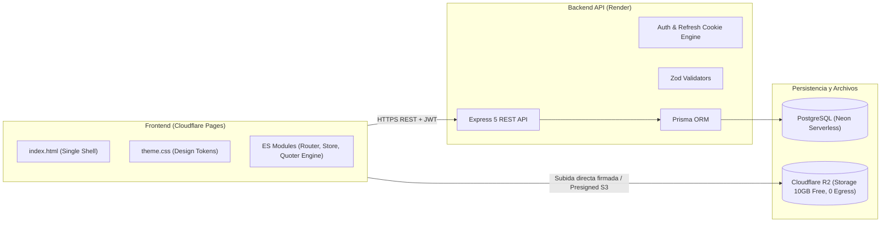

# Documentación Técnica, Arquitectura y Reglas de Negocio — Kroma Lab Sales Studio

> **Fuente Única de Verdad (Single Source of Truth):** Este documento reúne la arquitectura de software, modelos de datos, reglas de negocio de impresión UV DTF, algoritmos del cotizador, tokens del sistema de diseño (Light/Dark Mode), catálogo de endpoints y estructura física de archivos del proyecto **Kroma Lab Sales Studio**. Debe mantenerse permanentemente sincronizado con cada cambio en el código.

---

## Índice de Contenidos

1. [Visión General del Negocio y Arquitectura](#1-visión-general-del-negocio-y-arquitectura)
2. [Reglas Obligatorias de Ingeniería (Testing > 85% y Documentación)](#2-reglas-obligatorias-de-ingeniería-testing--85-y-documentación)
3. [Sistema de Diseño, Paleta de Colores y Temas (Light / Dark)](#3-sistema-de-diseño-paleta-de-colores-y-temas-light--dark)
4. [Algoritmo de Cotización y Reglas de Producción UV DTF](#4-algoritmo-de-cotización-y-reglas-de-producción-uv-dtf)
5. [Matriz Maestra de Roles y Permisos (RBAC)](#5-matriz-maestra-de-roles-y-permisos-rbac)
6. [Estructura del Monorepo y Mapa de Carpetas](#6-estructura-del-monorepo-y-mapa-de-carpetas)
7. [Arquitectura del Frontend (Vanilla HTML5, CSS3, ES Modules)](#7-arquitectura-del-frontend-vanilla-html5-css3-es-modules)
8. [Arquitectura del Backend (Express, Prisma, PostgreSQL Neon)](#8-arquitectura-del-backend-express-prisma-postgresql-neon)
9. [Almacenamiento de Archivos de Impresión (Cloudflare R2)](#9-almacenamiento-de-archivos-de-impresión-cloudflare-r2)

---

## 1. Visión General del Negocio y Arquitectura

**Kroma Lab Sales Studio** es la plataforma B2B integral de ventas, cotización y gestión operativa para el taller de impresión industrial **UV DTF** de Kroma Lab en Guatemala.

### Objetivos Estratégicos
1. **Captación de Tráfico Publicitario (Meta, TikTok, YouTube):**
   * Experiencia pública ultra veloz y sin barreras: landing page informativa y cotizador interactivo en tiempo real con simulación gráfica sobre la bobina de la impresora Audley.
   * Cierre comercial fluido: generación de cotización formal y enlace directo a WhatsApp/Lead con datos del cliente sin requerir registro previo obligatorio.
2. **Operación Interna y Fidelización B2B:**
   * Portal de autoservicio para clientes registrados recurrentes (reórdenes de pliegos, historial, subida de archivos TIFF/PNG a 300 DPI, saldo y estados).
   * Tablero de control de producción para empleados (seguimiento del flujo de la Audley: cola de impresión, impresión, laminado, corte de precisión y despacho).
   * Ventas de mostrador: registro manual de pedidos y altas rápidas de clientes no registrados para compras asistidas.
   * Escalabilidad a catálogo e-commerce para personalización de artículos promocionales terminados (termos, tazas, pachones).

### Topología de Infraestructura (Costo $0 / Q0)


---

## 2. Reglas Obligatorias de Ingeniería (Testing > 85% y Documentación)

1. **Pruebas Unitarias Obligatorias en Cada Tarea:**
   * Ningún archivo de lógica (cálculos, estado, enrutador, controladores, validadores) se entrega sin sus correspondientes pruebas en `__tests__/`.
2. **Umbral Mínimo de Cobertura (> 85%):**
   * Configurado en Vitest con límites estrictos: `statements: 85%`, `lines: 85%`, `functions: 85%`, `branches: 85%`.
3. **100% Tests Passing:**
   * Cero tolerancia a pruebas fallidas o advertencias no resueltas.
4. **Documentación Viva en `DOCUMENTATION.md`:**
   * Todo nuevo módulo, variable de entorno, cambio en precios o endpoints debe registrarse inmediatamente en este documento.

---

## 3. Sistema de Diseño, Paleta de Colores y Temas (Light / Dark)

La identidad de Kroma Lab se basa en 5 colores principales convertidos en variables CSS y tokens semánticos:

### Paleta Primaria de Marca
* **Space Indigo (`--space-indigo`):** `#21295c`
* **Regal Navy (`--regal-navy`):** `#1b3b6f`
* **Baltic Blue (`--baltic-blue`):** `#065a82`
* **Cerulean (`--cerulean`):** `#1c7293`
* **Powder Blue (`--powder-blue`):** `#9eb3c2`

### Mapeo Semántico por Tema

| Token Semántico | Modo Oscuro (`data-theme="dark"`) | Modo Claro (`data-theme="light"`) | Propósito |
| :--- | :--- | :--- | :--- |
| `--bg-page` | `#0d1224` (Indigo Profundo) | `#f4f7fb` (Blanco Hielo suave) | Fondo general del viewport |
| `--bg-surface` | `#161f3d` (Navy Oscuro) | `#ffffff` (Blanco puro) | Fondo de tarjetas y paneles |
| `--bg-surface-elevated`| `#1b294e` | `#eef3f8` (Powder Blue atenuado) | Modales, dropdowns y tooltips |
| `--border-color` | `rgba(158, 179, 194, 0.18)` | `rgba(27, 59, 111, 0.15)` | Líneas divisorias y bordes de inputs |
| `--border-focus` | `#1c7293` (*Cerulean*) | `#065a82` (*Baltic Blue*) | Enfoque de campos interactivos |
| `--text-primary` | `#ffffff` (Blanco brillante) | `#21295c` (*Space Indigo*) | Títulos y lectura principal |
| `--text-secondary` | `#9eb3c2` (*Powder Blue*) | `#475569` (Gris pizarra neutro) | Subtítulos y metadatos |
| `--text-muted` | `#64748b` | `#94a3b8` | Textos secundarios y placeholders |
| `--btn-primary-bg` | Linear Gradient (`#065a82` -> `#1c7293`) | `#1b3b6f` (*Regal Navy*) | Botones de acción principal |
| `--btn-primary-text` | `#ffffff` | `#ffffff` | Texto de botones primarios |
| `--accent-uv` | `#1c7293` (*Cerulean*) | `#065a82` (*Baltic Blue*) | Acentos visuales y barniz UV |
| `--status-success` | `#10b981` | `#059669` | Confirmaciones y badges pagados |
| `--status-warning` | `#f59e0b` | `#d97706` | Pendientes y alertas |
| `--status-danger` | `#ef4444` | `#dc2626` | Errores y cancelaciones |

---

## 4. Algoritmo de Cotización y Reglas de Producción UV DTF

El motor de cálculo emula con precisión el funcionamiento de la impresora industrial Audley:

### Parámetros de Bobina y Físicos
* **Ancho de Bobina:** 30 cm nominal.
* **Ancho Útil Imprimible (`printableWidthCm`):** `28.0 cm` (margen técnico de 1 cm por lado para tracción del film).
* **Separación entre Stickers (`marginBetweenCm`):** `0.3 cm` (3 mm).
* **Mínimo de Facturación:** `1.0 metro lineal` (`Q140.00`).

### Fórmulas del Motor Matemático
1. **Stickers por fila:**
   $$\text{stickersPerRow} = \max\left(1, \left\lfloor \frac{\text{printableWidthCm} + \text{gap}}{\text{widthCm} + \text{gap}} \right\rfloor\right)$$
2. **Filas requeridas:**
   $$\text{rows} = \left\lceil \frac{\text{qty}}{\text{stickersPerRow}} \right\rceil$$
3. **Largo físico en centímetros:**
   $$\text{lengthCm} = (\text{rows} \times (\text{heightCm} + \text{gap})) - \text{gap}$$
4. **Metros lineales reales:**
   $$\text{actualLinearMeters} = \frac{\text{lengthCm}}{100.0}$$
5. **Metros facturables:**
   $$\text{billableMeters} = \max(1.0, \text{actualLinearMeters})$$

### Escala de Precios de Impresión por Volumen
| Rango de Metros | Tarifa por Metro | Descripción Comercial |
| :--- | :--- | :--- |
| `0.01 m – 1.00 m` | **Q140.00 / m** (Tarifa Plana Base) | Pedido mínimo de entrada |
| `1.01 m – 4.99 m` | **Q115.00 / m** | Tiraje corto / emprendedor |
| `5.00 m – 9.99 m` | **Q105.00 / m** | Tiraje medio comercial |
| `10.00 m – 19.99 m` | **Q95.00 / m** | Mayorista frecuente |
| `20.00 m o más` | **Q85.00 / m** | Maquila industrial / Alto volumen |

### Servicio Opcional de Corte Recto de Precisión
* Si `includeCutting == true`:
  * `qty <= 50`: `Q0.35` / pieza
  * `51 <= qty <= 200`: `Q0.30` / pieza
  * `qty > 200`: `Q0.25` / pieza
  * **Tarifa Mínima de Corte:** `Q25.00` (si $\text{qty} \times \text{tarifa} < 25$, se cobra el piso de Q25).

---

## 5. Matriz Maestra de Roles y Permisos (RBAC)

El acceso sigue la directriz **Default-Deny**:

| Código de Permiso | Descripción | Roles Autorizados |
| :--- | :--- | :--- |
| `PUBLIC_ACCESS` | Acceso a Landing Page, información de contacto y cotizador público | `VISITOR`, `CUSTOMER`, `EMPLOYEE`, `ADMIN` |
| `SUBMIT_LEAD` | Enviar cotización pública por WhatsApp o registrar lead | `VISITOR`, `CUSTOMER`, `EMPLOYEE`, `ADMIN` |
| `VIEW_OWN_ORDERS` | Ver historial de pedidos propios y estados de producción | `CUSTOMER`, `ADMIN` |
| `CREATE_CUSTOMER_ORDER`| Crear pedido formal con subida de archivos de impresión | `CUSTOMER`, `EMPLOYEE`, `ADMIN` |
| `UPLOAD_PRINT_ASSETS` | Subir archivos TIFF/PNG pesados a Cloudflare R2 | `CUSTOMER`, `EMPLOYEE`, `ADMIN` |
| `MANAGE_PRODUCTION` | Cambiar estados de la cola de impresión Audley | `EMPLOYEE`, `ADMIN` |
| `MANAGE_ALL_ORDERS` | Ver, modificar, cancelar y facturar pedidos generales | `EMPLOYEE`, `ADMIN` |
| `CREATE_WALKIN_ORDER` | Crear pedidos en mostrador para clientes sin cuenta previa | `EMPLOYEE`, `ADMIN` |
| `MANAGE_CLIENTS` | Directorio de clientes, datos fiscales (NIT) y teléfonos | `EMPLOYEE`, `ADMIN` |
| `MANAGE_USERS` | Invitar empleados y administrar credenciales | `ADMIN` |
| `MANAGE_ROLES_PERMS` | Configurar matriz de permisos RBAC | `ADMIN` |
| `CONFIG_PRICING_TIERS`| Modificar tarifas por metro del cotizador | `ADMIN` |

### Regla Específica de Visibilidad de Marca en Navbar:
* **"KROMA LAB":** Visible universalmente para todos los usuarios (Visitantes, Clientes, Empleados y Administradores).
* **"Sales Studio":** Oculto por defecto (`display: none`). **Únicamente visible cuando el usuario tiene rol `ADMIN` o `EMPLOYEE`**. Los clientes y visitantes no registrados jamás ven el texto "Sales Studio", manteniendo un perfil limpio hacia el consumidor.

---

## 6. Estructura del Monorepo y Mapa de Carpetas

```text
kroma-lab-sales-studio/
├── GEMINI.md                       # Reglas operativas y mandatos para el Agente IA
├── DOCUMENTATION.md                # Fuente Única de Verdad viva del proyecto
├── frontend/                       # Aplicación Web Vanilla (HTML5, CSS3, ES Modules)
│   ├── index.html                  # Shell único con logo oficial SVG y cotizador
│   ├── _redirects                  # Configuración de routing SPA para Cloudflare Pages
│   ├── package.json                # Dependencias de testing (Vitest, JSDOM) y scripts
│   ├── vitest.config.js            # Configuración de pruebas unitarias (>85% coverage)
│   ├── src/
│   │   ├── css/
│   │   │   ├── theme.css           # Tokens de diseño y variables CSS (Light/Dark)
│   │   │   ├── base.css            # Reset, tipografía y utilidades
│   │   │   └── views.css           # Estilos de vistas (cotizador, bobina, despiece)
│   │   ├── shared/
│   │   │   └── business-config.js  # Constantes de negocio espejadas para el cliente
│   │   └── js/
│   │       ├── app.js              # Punto de entrada, sincronización de rol y cotizador
│   │       ├── store.js            # Estado reactivo global (usuario, token, tema)
│   │       └── modules/
│   │           ├── quoter-engine.js    # Motor puro de cálculo matemático
│   │           └── roll-simulator.js   # Renderizador interactivo en Canvas (28 cm)
│   └── __tests__/                  # 31 pruebas unitarias de frontend (> 85% coverage)
│       ├── quoter-engine.test.js   # 14 tests de cálculo, mínimas y escalas
│       ├── store.test.js           # 5 tests de estado y reactividad
│       ├── roll-simulator.test.js  # 3 tests de Canvas 2D
│       ├── app.test.js             # 9 tests de DOM, roles y WhatsApp
│       └── setup.js                # Mock de Canvas para JSDOM
├── backend/                        # API REST (Node.js, Express, Prisma)
│   ├── package.json                # Scripts y dependencias backend
│   ├── tsconfig.json               # Configuración TypeScript
│   └── prisma/
│       └── schema.prisma           # Esquema de base de datos Neon PostgreSQL
└── shared/                         # Constantes maestras de negocio
    └── business-config.js
```


---

## 7. Arquitectura del Frontend (Vanilla HTML5, CSS3, ES Modules)

* **Sin compilación requerida en producción:** El código se ejecuta directamente como módulos ECMAScript nativos (`<script type="module" src="/src/js/app.js">`).
* **Enrutamiento SPA:** El archivo `_redirects` en Cloudflare Pages redirige todas las rutas a `/index.html 200`. El `router.js` lee `window.location.pathname`, maneja eventos `popstate` y despacha la vista adecuada.
* **Persistencia Local:** Preferencia de tema (`localStorage['theme']`), tokens de autenticación y cotizaciones borrador.

---

## 8. Arquitectura del Backend (Express, Prisma, PostgreSQL Neon)

* Modelos base inspirados en Arte Modelo pero adaptados a metros lineales y órdenes de producción de UV DTF:
  * `User`: Credenciales con `bcrypt`, roles (`ADMIN`, `EMPLOYEE`, `CUSTOMER`), tokens de verificación y refresh.
  * `Customer`: Datos de empresa/cliente, NIT, teléfono de WhatsApp, vinculación a pedidos.
  * `Order`: Medidas en cm, cantidad de piezas, metros lineales calculados, costo de impresión, costo de corte, URL de diseño en Cloudflare R2, estado de producción (`PENDING`, `IN_AUDLEY_QUEUE`, `PRINTING`, `LAMINATING_CUTTING`, `READY_FOR_DELIVERY`, `DELIVERED`).
  * `Quote`: Registro de cotizaciones guardadas para auditoría y seguimiento comercial.

---

## 9. Almacenamiento de Archivos de Impresión (Cloudflare R2)

* Los archivos `.PNG` y `.TIFF` a 300 DPI se almacenan directamente en un bucket de **Cloudflare R2** mediante URLs prefirmadas (Pre-signed S3 URLs) generadas por el backend, eliminando cualquier saturación de ancho de banda en el servidor de Render y garantizando **$0 de costo de transferencia (egress)**.
