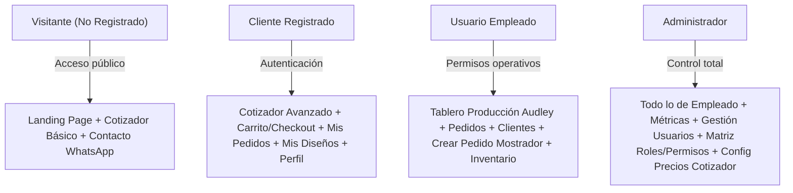

# Guía Maestra, Arquitectura y Reglas del Proyecto — Kroma Lab Sales Studio

> **Propósito de este documento:** Servir como fuente única de verdad (Single Source of Truth) y directriz operativa para el agente de IA (Antigravity / Gemini) y desarrolladores en el proyecto **Kroma Lab Sales Studio**. Cualquier implementación o modificación de código debe alinearse estrictamente con los principios, arquitectura y reglas aquí estipuladas.

---

## 1. Visión General del Negocio y Alcance

**Kroma Lab Sales Studio** es una plataforma web híbrida diseñada para el negocio de impresión **UV DTF** y personalización de artículos en Guatemala (moneda base: Quetzales - `GTQ` / `Q`).

El sistema cumple una doble función estratégica:
1. **Embudo Público de Ventas y Captación (Tráfico de Anuncios):**
   * Landing page de alta conversión para visitantes provenientes de Meta Ads (Facebook/Instagram), TikTok Ads y YouTube.
   * Cotizador interactivo instantáneo de metros lineales / pliegos de UV DTF.
   * Captura de leads transparente (guarda la cotización y datos básicos de contacto vía WhatsApp/correo sin fricciones de registro extensas).
2. **Portal B2B de Clientes y Sistema ERP/Operativo Interno:**
   * Portal de autoservicio para clientes registrados: historial de pedidos, reorden instantánea, subida de archivos de impresión de alta resolución, seguimiento de estados de producción y facturación/pagos.
   * Panel de control para empleados y administradores para operar la cola de impresión de la máquina Audley, administrar clientes, catálogo y generar pedidos para clientes no registrados (ventas por WhatsApp/mostrador).
   * Módulo futuro de catálogo e-commerce para producto terminado (termos, tazas, pachones, etc.) con carrito de compras integrado.
   * Integración futura de chatbot de atención al cliente entrenado con la API de Gemini.

---

## 2. Pila Tecnológica y Hosting (Infraestructura de Costo Mínimo)

La arquitectura está diseñada para mantener los costos fijos en **$0.00 / Q0.00** durante la fase inicial y de crecimiento temprano:

| Componente | Tecnología Seleccionada | Proveedor de Hosting / Infraestructura | Nivel / Plan |
| :--- | :--- | :--- | :--- |
| **Estructura Repo** | Monorepo (`frontend/`, `backend/`, `shared/`) | GitHub (`MiguelDP4/kroma-lab-sales-studio`) | Público / Privado |
| **Frontend Web** | Vanilla HTML5, CSS3 moderno (Custom Properties, Nesting, Grid/Flexbox), JavaScript nativo (ES Modules, SPA Router, Reactive Store) | **Cloudflare Pages** | **Free Tier ($0)** (Ancho de banda ilimitado, SSL automático, routing SPA nativo vía `_redirects`) |
| **Backend API** | Node.js + Express + TypeScript + Prisma ORM + Zod | **Render** | **Free Tier ($0)** (Web Service) |
| **Base de Datos** | PostgreSQL relacional | **Neon Serverless PostgreSQL** | **Free Tier ($0)** (0.5 GB almacenamiento, escalado automático) |
| **Almacenamiento de Archivos** | Archivos de impresión de alta resolución (TIFF, PNG 300 DPI, PDF) y vistas previas | **Cloudflare R2** | **Free Tier ($0)** (10 GB/mes gratis, **cero costo por ancho de banda / egress fees**) |

---

## 3. Matriz de Control de Acceso y Roles (RBAC)

El frontend y el backend operan bajo una política estricta de **Default-Deny (Oculto y bloqueado por defecto)**:

### Detalle de Capacidades por Rol:
1. **Visitante (Sin Registrar):**
   * Vista de inicio con catálogo visual de trabajos realizados.
   * Uso del cotizador público para estimar costos.
   * Bloqueo de carrito directo (se invita a registrarse o a enviar la cotización directa a WhatsApp).
2. **Cliente Registrado:**
   * Acceso completo al cotizador con precios B2B aplicados.
   * Carrito de compras y checkout.
   * Panel de pedidos propios: estados de producción en tiempo real, histórico de compras y saldos.
   * Repositorio de sus artes gráficas enviadas.
3. **Empleado:**
   * Tablero de control de producción (estados de orden: *En Cola Audley -> Impreso -> Laminado/Corte -> Listo -> Entregado*).
   * Lista general de pedidos y detalle de ítems.
   * Directorio de clientes.
   * **Creación de pedidos en mostrador:** Facilidad para registrar clientes no registrados in-situ o pedidos tomados por teléfono/WhatsApp.
   * Control de inventario de consumibles (rollos film UV DTF, tintas, barniz) y productos terminados.
4. **Administrador:**
   * Acceso irrestricto a todas las funciones operativas de empleado.
   * Gestión completa de usuarios (invitar empleados, vincular cuentas de clientes).
   * Configuración de roles y asignación granular de permisos.
   * Panel de configuración de tarifas del cotizador (precio por metro lineal, escalas por volumen, costos de acabados/diseño).

---

## 4. Regla Obligatoria de Pruebas Unitarias y Cobertura (> 85%)

> **IMPORTANTE — NORMA DE CALIDAD NO NEGOCIABLE:**
> Inspirado en el estándar de calidad de Arte Modelo, cualquier funcionalidad, módulo o cambio introducido en este repositorio debe respetar el siguiente protocolo de testing:

1. **Pruebas Unitarias Obligatorias en Cada Tarea:**
   * Todo nuevo endpoint, controlador, middleware, validador Zod, función de servicio, enrutador de frontend, componente o módulo de estado reactivo debe incluir sus tests correspondientes dentro de carpetas `__tests__/`.
   * No se dará por finalizada ninguna tarea de programación si el código nuevo carece de pruebas unitarias.
2. **Umbral Mínimo de Cobertura (> 85%):**
   * La suite de pruebas (configurada con Vitest tanto para backend como para frontend) debe mantener una cobertura mínima obligatoria de:
     * `statements >= 85%`
     * `lines >= 85%`
     * `functions >= 85%`
     * `branches >= 85%`
3. **100% Tests Passing:**
   * Tras cualquier cambio en el código, se debe ejecutar la suite de pruebas (`npm test` / `npm run test:coverage`).
   * **El 100% de las pruebas deben pasar sin errores.** Queda estrictamente prohibido commitear o entregar tareas con pruebas rotas o fallidas.

---

## 5. Directrices de Arquitectura del Código

### A. Frontend (Vanilla HTML5, CSS3, ES Modules)
* **Cero Frameworks Pesados:** Nada de React, Angular, Vue o Next.js. El código se ejecuta directamente en el navegador.
* **Modularidad Limpia (`src/`):**
  * `index.html`: Shell único de la aplicación.
  * `css/`: Variables maestras de diseño (`theme.css`), reseteo y estilos modulares.
  * `js/router.js`: Enrutador SPA ligero basado en el History API (`pushState`, `popstate`).
  * `js/store.js`: Manejo de estado reactivo global para usuario autenticado, token JWT y permisos.
  * `js/api/`: Cliente de consumo REST centralizado con refresco automático de JWT (proactivo y reactivo ante HTTP 401).
  * `js/views/`: Vistas independientes (`home.js`, `quoter.js`, `orders.js`, `admin.js`, etc.).
  * `js/components/`: Componentes UI reutilizables (modales `<dialog>`, tablas con paginación, notificaciones toast, uploader drag-and-drop).

### B. Backend (Node.js, Express, Prisma, PostgreSQL)
* **Arquitectura por Capas:** Rutas (`routes/`) -> Middlewares (`middlewares/`) -> Controladores (`controllers/`) -> Servicios/Base de Datos (`prisma/`).
* **Seguridad:**
  * Hasheo seguro de contraseñas con `bcryptjs`.
  * Tokens de sesión JWT de corta duración + `refreshToken` seguro con hash en base de datos y cookies `httpOnly`.
  * Validación exhaustiva de payloads con esquemas `Zod`.
  * IDs legibles con prefijo identificador (`USR_`, `CUS_`, `ORD_`, `PRD_`, etc.).
